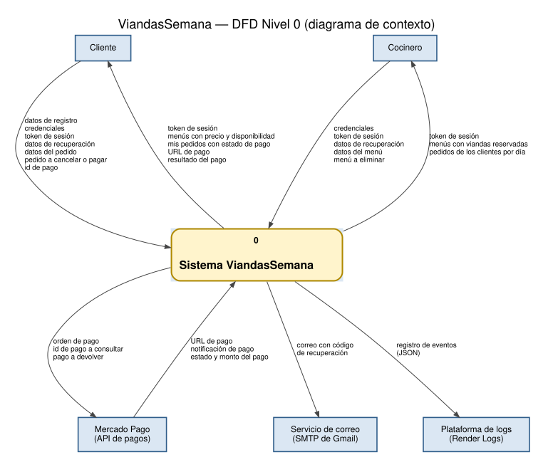
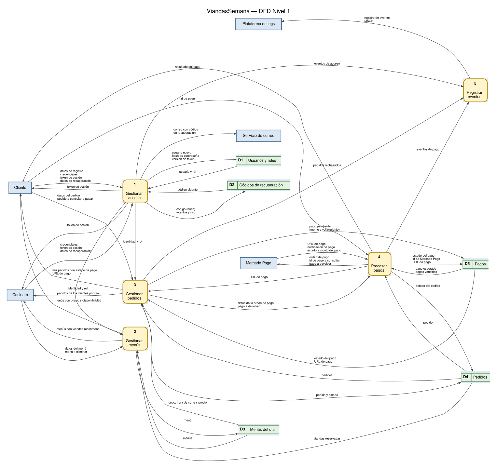

# Diagramas de flujo de datos (DFD)

Notación **Gane-Sarson**: entidades externas en rectángulos azules, procesos en rectángulos
redondeados amarillos con su número, almacenes de datos en rectángulos abiertos verdes con su código
(D1…D5). Cada flujo lleva el **dato** que viaja, no la acción que lo origina. Los procesos de otro
nivel que aparecen en un diagrama de nivel 2 se dibujan en gris.

Todas las peticiones de Cliente y Cocinero (salvo registro, inicio de sesión y recuperación) llevan el
token de sesión; por eso "token de sesión" aparece como flujo de entrada en el Nivel 0 y llega al
proceso 1, que entrega "identidad y rol" a los demás procesos.

## Nivel 0 — Diagrama de contexto (consigna 4.1)

| Entidad externa | Flujos de entrada al sistema | Flujos de salida del sistema |
|---|---|---|
| Cliente | datos de registro · credenciales · token de sesión · datos de recuperación · datos del pedido · pedido a cancelar o pagar · id de pago | token de sesión · menús con precio y disponibilidad · mis pedidos con estado de pago · URL de pago · resultado del pago |
| Cocinero | credenciales · token de sesión · datos de recuperación · datos del menú · menú a eliminar | token de sesión · menús con viandas reservadas · pedidos de los clientes por día |
| Mercado Pago | URL de pago · notificación de pago · estado y monto del pago | orden de pago · id de pago a consultar · pago a devolver |
| Servicio de correo | — | correo con código de recuperación |
| Plataforma de logs | — | registro de eventos (JSON) |

## Nivel 1 (consigna 4.2)

| N.º | Proceso | Módulo | Almacenes |
|---|---|---|---|
| 1 | Gestionar acceso | [Acceso](modulos/modulo-1-acceso.md) | D1 Usuarios y roles, D2 Códigos de recuperación |
| 2 | Gestionar menús | [Menús](modulos/modulo-2-menus.md) | D3 Menús del día, D4 Pedidos (lectura) |
| 3 | Gestionar pedidos | [Pedidos](modulos/modulo-3-pedidos.md) | D3, D4, D5 |
| 4 | Procesar pagos | [Pagos](modulos/modulo-4-pagos.md) | D4, D5 |
| 5 | Registrar eventos | [Plataforma](modulos/modulo-5-plataforma.md) | — (los eventos van a la plataforma de logs) |

| Almacén | Tabla(s) de la base |
|---|---|
| D1 Usuarios y roles | `Usuario`, `Rol` |
| D2 Códigos de recuperación | `CodigoRecuperacion` |
| D3 Menús del día | `MenuDia` |
| D4 Pedidos | `Pedido` |
| D5 Pagos | `Pago` |

### Consistencia entre el Nivel 0 y el Nivel 1

Cada flujo del diagrama de contexto aparece en el Nivel 1, con el mismo nombre, conectado al proceso
que lo produce o lo consume. No hay en el Nivel 1 flujos con entidades externas que no estén en el
Nivel 0.

| Flujo del Nivel 0 | Sentido | Proceso del Nivel 1 |
|---|---|---|
| datos de registro | Cliente → sistema | 1 |
| credenciales | Cliente, Cocinero → sistema | 1 |
| token de sesión | Cliente, Cocinero → sistema | 1 |
| datos de recuperación | Cliente, Cocinero → sistema | 1 |
| token de sesión | sistema → Cliente, Cocinero | 1 |
| correo con código de recuperación | sistema → Servicio de correo | 1 |
| datos del menú · menú a eliminar | Cocinero → sistema | 2 |
| menús con viandas reservadas | sistema → Cocinero | 2 |
| menús con precio y disponibilidad | sistema → Cliente | 2 |
| datos del pedido · pedido a cancelar o pagar | Cliente → sistema | 3 |
| mis pedidos con estado de pago · URL de pago | sistema → Cliente | 3 |
| pedidos de los clientes por día | sistema → Cocinero | 3 |
| id de pago | Cliente → sistema | 4 |
| resultado del pago | sistema → Cliente | 4 |
| orden de pago · id de pago a consultar · pago a devolver | sistema → Mercado Pago | 4 |
| URL de pago · notificación de pago · estado y monto del pago | Mercado Pago → sistema | 4 |
| registro de eventos (JSON) | sistema → Plataforma de logs | 5 |

## Nivel 2 (consigna 4.3)

Se descomponen los cuatro procesos que manejan datos del negocio. La numeración es jerárquica y cada
diagrama usa sólo los flujos que su proceso tiene en el Nivel 1 (en el proceso 3, "pedido a cancelar o
pagar" se separa en "pedido a cancelar" y "pedido a pagar"). La descripción de cada subproceso está en
el documento de su módulo.

### Proceso 1 — Gestionar acceso

### Proceso 2 — Gestionar menús

### Proceso 3 — Gestionar pedidos

### Proceso 4 — Procesar pagos

| Subproceso | Qué hace | Código |
|---|---|---|
| 1.1 Registrar usuario | Valida, hashea la contraseña y crea un CLIENTE | `POST /api/auth/registro` |
| 1.2 Iniciar sesión | Compara la contraseña y emite el JWT | `POST /api/auth/login` |
| 1.3 Validar sesión | Verifica el token y lee el rol de la base | `autenticar` |
| 1.4 Cerrar sesión | Sube `versionToken` | `POST /api/auth/logout` |
| 1.5 Emitir código de recuperación | Genera el código, guarda su HMAC y lo manda por correo | `POST /api/auth/recuperar` |
| 1.6 Restablecer contraseña | Verifica el código y guarda la contraseña nueva | `POST /api/auth/recuperar/verificar` y `/cambiar` |
| 2.1 Validar datos del menú | zod + rol COCINERO | `esquemaMenu`, `exigirRol` |
| 2.2 Guardar menú | Crea o modifica controlando la fecha única | `POST` / `PUT /api/menus` |
| 2.3 Eliminar menú | Borra si no tiene pedidos | `DELETE /api/menus/:id` |
| 2.4 Calcular disponibilidad | Suma reservas y calcula `disponibles` y `abierto` | `conTotales` |
| 3.1 Validar pedido | Cupo y hora de corte, con la fila del menú bloqueada | `validarNuevoPedido` |
| 3.2 Registrar reserva | Crea pedido y pago pendientes | `POST /api/pedidos` |
| 3.3 Consultar pedidos | Lista según el rol, con `cancelable` y `pagable` | `GET /api/pedidos` |
| 3.4 Cancelar pedido | Controla el corte y cancela (pide devolución si estaba pagado) | `PATCH /api/pedidos/:id/cancelar` |
| 3.5 Entregar URL de pago | Devuelve la URL para reintentar | `POST /api/pedidos/:id/pagar` |
| 4.1 Crear orden de pago | Crea la preferencia de Checkout Pro | `crearPreferencia` |
| 4.2 Consultar estado del pago | Consulta `GET /v1/payments/{id}` | `obtenerPago` |
| 4.3 Actualizar reserva | Confirma, deja pendiente o manda a devolver | `procesarPago` |
| 4.4 Devolver pago | Pide la devolución total | `devolverPago` |
| 4.5 Vencer reservas impagas | Cancela reservas con el plazo vencido | `vencerReservasImpagas` |
