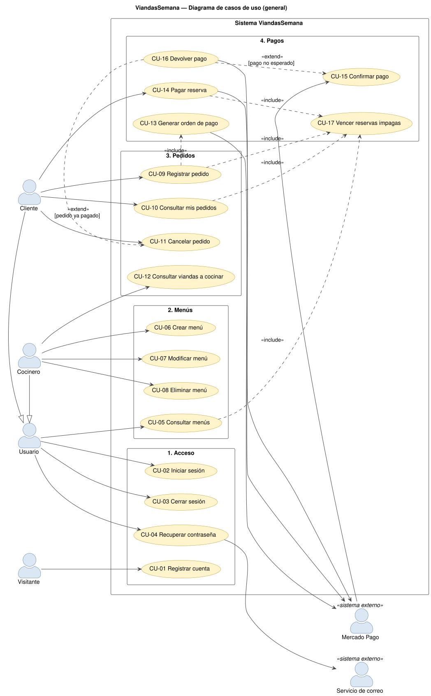

# Casos de uso (consigna 4.4)

## 1. Diagrama general

## 2. Actores

| Actor | Tipo | Participa en |
|---|---|---|
| Visitante | humano | CU-01 |
| Usuario (generalización de Cliente y Cocinero) | humano | CU-02, CU-03, CU-04, CU-05 |
| Cliente | humano | CU-09, CU-10, CU-11, CU-14 (y los de Usuario) |
| Cocinero | humano | CU-06, CU-07, CU-08, CU-12 (y los de Usuario) |
| Mercado Pago | sistema externo | CU-13, CU-14, CU-15 (actor principal: avisa los pagos por webhook), CU-16 |
| Servicio de correo | sistema externo | CU-04 |

No hay procesos programados: el vencimiento de reservas impagas (CU-17) se ejecuta incluido en otros
casos de uso, justo antes de contar el cupo (ver la justificación en el módulo 4).

## 3. Catálogo por módulo

| Módulo | Caso de uso | Actor principal | Endpoint |
|---|---|---|---|
| 1 Acceso | CU-01 Registrar cuenta | Visitante | `POST /api/auth/registro` |
| | CU-02 Iniciar sesión | Usuario | `POST /api/auth/login` |
| | CU-03 Cerrar sesión | Usuario | `POST /api/auth/logout` |
| | CU-04 Recuperar contraseña | Usuario | `POST /api/auth/recuperar`, `/verificar`, `/cambiar` |
| 2 Menús | CU-05 Consultar menús | Usuario | `GET /api/menus`, `GET /api/menus/:id` |
| | CU-06 Crear menú | Cocinero | `POST /api/menus` |
| | CU-07 Modificar menú | Cocinero | `PUT /api/menus/:id` |
| | CU-08 Eliminar menú | Cocinero | `DELETE /api/menus/:id` |
| 3 Pedidos | **CU-09 Registrar pedido** ★ | Cliente | `POST /api/pedidos` |
| | CU-10 Consultar mis pedidos | Cliente | `GET /api/pedidos` |
| | **CU-11 Cancelar pedido** ★ | Cliente | `PATCH /api/pedidos/:id/cancelar` |
| | CU-12 Consultar viandas a cocinar | Cocinero | `GET /api/pedidos` |
| 4 Pagos | CU-13 Generar orden de pago | (incluido en CU-09) | Mercado Pago `POST /checkout/preferences` |
| | CU-14 Pagar reserva | Cliente | `POST /api/pedidos/:id/pagar` |
| | **CU-15 Confirmar pago** ★ | Mercado Pago | `POST /api/pagos/notificacion` |
| | CU-16 Devolver pago | (extiende CU-11 y CU-15) | Mercado Pago `POST /v1/payments/{id}/refunds` |
| | CU-17 Vencer reservas impagas | (incluido en CU-05, CU-09, CU-10, CU-14) | — |

★ = caso de uso principal (su narrativa está abajo). Las plantillas completas de **todos** los casos
de uso están en el documento de cada módulo:
[Acceso](modulos/modulo-1-acceso.md) · [Menús](modulos/modulo-2-menus.md) ·
[Pedidos](modulos/modulo-3-pedidos.md) · [Pagos](modulos/modulo-4-pagos.md).

## 4. Relaciones `<<include>>` y `<<extend>>`

| Relación | Por qué |
|---|---|
| CU-09 `<<include>>` CU-13 Generar orden de pago | Toda reserva genera siempre su orden de pago: sin ella la reserva se cancela |
| CU-05, CU-09, CU-10, CU-14 `<<include>>` CU-17 Vencer reservas impagas | Comportamiento común que se ejecuta **siempre** antes de mostrar o contar el cupo |
| CU-16 Devolver pago `<<extend>>` CU-11 Cancelar pedido | Sólo ocurre si el pedido cancelado **ya estaba pagado** |
| CU-16 Devolver pago `<<extend>>` CU-15 Confirmar pago | Sólo ocurre si llega un pago aprobado **no esperado** (reserva vencida o cancelada, monto distinto, pago doble) |
| Cliente y Cocinero son un Usuario (generalización) | Los dos inician y cierran sesión, recuperan la contraseña y consultan menús |

No se usa `<<include>>` para "validar sesión": es una precondición de todos los casos de uso con
sesión y dibujarla en cada uno no agrega información.

## 5. Narrativas de los tres casos de uso principales

Son los que sostienen el negocio: reservar con cupo y horario (CU-09), confirmar la reserva sólo con
el pago real (CU-15) y cancelar con devolución (CU-11). Son copia de las plantillas de sus módulos.

### CU-09 Registrar pedido ★ (caso de uso principal)

| Campo | Detalle |
|---|---|
| **Módulo** | 3 — Pedidos |
| **Actor principal** | Cliente |
| **Actores secundarios** | Mercado Pago (a través de CU-13) |
| **Descripción** | El cliente reserva una o más viandas de un menú; la reserva queda pendiente de pago y el cliente pasa a pagar en Mercado Pago. |
| **Precondiciones** | Sesión iniciada con rol `CLIENTE`. El menú existe, tiene precio y está abierto. |
| **Disparador** | El cliente elige la cantidad y toca "Reservar y pagar" en la tarjeta de un menú. |
| **Relaciones** | `<<include>>` CU-17 Vencer reservas impagas · `<<include>>` CU-13 Generar orden de pago |
| **Endpoint** | `POST /api/pedidos` `{ menuId, cantidad }` → `201 { ...pedido, pago, urlPago }` |

**Flujo principal**

1. El cliente indica la cantidad y toca "Reservar y pagar".
2. El frontend envía `POST /api/pedidos` con el token.
3. La API valida la sesión y que el rol sea `CLIENTE`.
4. La API valida los datos con zod (`menuId` entero positivo, `cantidad` entero ≥ 1).
5. La API abre una transacción y **bloquea la fila del menú** (`SELECT … FOR UPDATE`): si llegan dos pedidos a la vez, el segundo espera al primero.
6. La API verifica que el menú tenga precio.
7. La API cancela las reservas impagas vencidas (CU-17) para que no ocupen cupo.
8. La API suma las viandas de los pedidos `PENDIENTE_PAGO` y `CONFIRMADO` del menú.
9. La API aplica `validarNuevoPedido`: la hora de corte no pasó y la cantidad no supera las viandas disponibles.
10. La API crea el pedido (`PENDIENTE_PAGO`) y su pago (`PENDIENTE`, `monto = cantidad × precio`, vencimiento = 30 minutos o la hora de corte, lo que ocurra antes) y confirma la transacción.
11. La API genera la orden de pago en Mercado Pago (CU-13), guarda su id y la URL de pago.
12. La API responde `201` con el pedido, el pago y `urlPago`.
13. El frontend avisa "Te llevamos a Mercado Pago para pagar tu reserva…" y redirige al cliente a `urlPago` (continúa en CU-14).

**Flujos alternativos**

- **3a. Sin sesión:** `401`. **3b. Rol COCINERO:** `403`.
- **4a. Datos inválidos:** `400` con el detalle por campo.
- **5a. El menú no existe:** `404 "Menú no encontrado"`; se deshace la transacción.
- **6a. Menú sin precio:** `409 SIN_PRECIO "Este menú todavía no tiene precio"`.
- **9a. Pasó la hora de corte:** `409 FUERA_DE_HORARIO`; se registra el evento `regla_negocio` en el log.
- **9b. No alcanza el cupo:** `409 CUPO_COMPLETO` con "No quedan viandas disponibles para este día" o "Sólo quedan N viandas"; se registra `regla_negocio`.
- **11a. Mercado Pago no responde, falla o no está configurado:** el pedido y su pago pasan a `CANCELADO` (libera el cupo) y la API responde `502`/`503` con "Probá de nuevo en unos minutos"; el error queda en el log.

**Postcondiciones**

- Éxito: existe un `Pedido` `PENDIENTE_PAGO` con su `Pago` `PENDIENTE` y la URL de pago; las viandas quedan apartadas del cupo hasta que se pague, se cancele o venza.
- Fracaso: no queda ninguna reserva ocupando cupo.

**Reglas de negocio:** cupo máximo por día; no se pide después de la hora de corte; dos pedidos
simultáneos nunca superan el cupo (bloqueo de fila + transacción).

### CU-15 Confirmar pago ★ (caso de uso principal)

| Campo | Detalle |
|---|---|
| **Módulo** | 4 — Pagos |
| **Actor principal** | Mercado Pago (webhook). También lo dispara el frontend cuando el cliente vuelve de pagar. |
| **Actores secundarios** | Cliente (recibe el resultado) |
| **Descripción** | El sistema consulta el estado real de un pago y actualiza la reserva: la confirma, la deja pendiente o devuelve el dinero. |
| **Precondiciones** | Existe un pago en Mercado Pago cuyo `external_reference` es el id de un pedido. |
| **Disparador** | `POST /api/pagos/notificacion` con `{ type: "payment", data: { id } }` (o los mismos datos en la URL). |
| **Relaciones** | Extendido por CU-16 Devolver pago `[pago no esperado]` |
| **Endpoint** | `POST /api/pagos/notificacion` → `200 { pedidoId, estadoPedido, estadoPago }` (público: no lleva token) |

**Flujo principal**

1. Mercado Pago (o el frontend, al volver el cliente) envía el aviso con el id del pago.
2. La API ignora los avisos que no son de tipo `payment` (responde `200 { ignorado: true }`).
3. La API valida que el id sea numérico.
4. La API consulta `GET /v1/payments/{id}` a Mercado Pago: estado, monto, moneda y `external_reference`.
5. La API traduce el estado (`approved` → `APROBADO`, `rejected` → `RECHAZADO`, `cancelled` → `CANCELADO`, `refunded`/`charged_back` → `DEVUELTO`, el resto → `PENDIENTE`).
6. En una transacción, bloquea la fila del pedido (`FOR UPDATE`) para procesar de a un aviso.
7. Si el aviso ya se procesó (mismo id y mismo estado), no cambia nada (idempotente).
8. Si el pago está `APROBADO`, el pedido está `PENDIENTE_PAGO` y el monto y la moneda (ARS) coinciden: el pago pasa a `APROBADO` con el id de Mercado Pago y el pedido a `CONFIRMADO`; se registra `pago_aprobado`.
9. La API responde el estado del pedido y del pago; el frontend muestra "¡Pago aprobado! Tu reserva está confirmada." y abre "Mis pedidos".

**Flujos alternativos**

- **2a. Aviso de otro tipo (por ejemplo `merchant_order`):** `200 { ignorado: true }`, para que Mercado Pago no lo reintente.
- **3a. Id inválido:** `400`.
- **4a. El pago no existe en Mercado Pago:** `404`. **4b. Mercado Pago no responde:** `502` (Mercado Pago reintenta el webhook más tarde).
- **6a. El pago no corresponde a ninguna reserva:** `404 "El pago no corresponde a ninguna reserva"`.
- **8a. Pago pendiente, rechazado o cancelado:** el pago guarda ese estado y el pedido **sigue** `PENDIENTE_PAGO`; el cliente puede reintentar hasta que venza. El frontend muestra "El pago no se aprobó…" o "Mercado Pago está procesando el pago…".
- **8b. Pago aprobado pero la reserva ya estaba cancelada o vencida, el monto no coincide o la reserva ya estaba pagada con otro pago:** se ejecuta CU-16 Devolver pago y se registra `pago_devuelto`. Si el pedido no estaba confirmado, el pago queda `DEVUELTO`.
- **8c. Devolución o contracargo hecho desde Mercado Pago sobre una reserva confirmada:** el pago pasa a `DEVUELTO` y el pedido a `CANCELADO` (libera el cupo).

**Postcondiciones:** el estado de la reserva coincide con el estado real del pago en Mercado Pago.
Ninguna reserva se confirma sin un pago aprobado por el monto exacto.

**Reglas:** Mercado Pago es la única fuente de verdad del pago; repetir el aviso no cambia nada; dos
avisos simultáneos del mismo pago se procesan de a uno.

### CU-11 Cancelar pedido ★ (caso de uso principal)

| Campo | Detalle |
|---|---|
| **Módulo** | 3 — Pedidos |
| **Actor principal** | Cliente |
| **Actores secundarios** | Mercado Pago (si hay que devolver el dinero) |
| **Descripción** | El cliente cancela una reserva propia antes de la hora de corte; si ya estaba pagada, se le devuelve el dinero. |
| **Precondiciones** | Sesión con rol `CLIENTE`; el pedido es del cliente y no está cancelado. |
| **Disparador** | El cliente toca "Cancelar" en "Mis pedidos" y confirma. |
| **Relaciones** | Extendido por CU-16 Devolver pago `[pedido ya pagado]` |
| **Endpoint** | `PATCH /api/pedidos/:id/cancelar` → `200` |

**Flujo principal**

1. El frontend pide confirmación; si el pedido está pagado agrega "Te devolvemos el pago por Mercado Pago".
2. El frontend envía `PATCH /api/pedidos/:id/cancelar`.
3. La API valida la sesión, el rol `CLIENTE` y que el id sea un entero positivo.
4. La API abre una transacción y **bloquea la fila del pedido** (`FOR UPDATE`) para que no se confirme un pago mientras se cancela.
5. La API verifica que el pedido exista y sea del usuario del token.
6. La API aplica `validarCancelacion`: el pedido no está cancelado y no pasó la hora de corte del menú.
7. Si el pago estaba `PENDIENTE` o `RECHAZADO`, lo pasa a `CANCELADO`.
8. La API pasa el pedido a `CANCELADO` (libera el cupo) y lo devuelve.
9. El frontend muestra "Pedido cancelado" y recarga la lista.

**Flujos alternativos**

- **3a. Rol COCINERO:** `403`. **3b. Id inválido:** `400`.
- **5a. El pedido no existe o es de otro cliente:** `404 "Pedido no encontrado"` (no revela que existe).
- **6a. Ya estaba cancelado:** `409 YA_CANCELADO`.
- **6b. Pasó la hora de corte:** `409 FUERA_DE_HORARIO` ("No se puede cancelar un pedido después del horario de corte").
- **7a. El pedido estaba pagado (`APROBADO`):** se ejecuta CU-16 Devolver pago; el pago queda `DEVUELTO` y se registra `pago_devuelto`.
- **7b. Mercado Pago falla al devolver:** la transacción se deshace, el pedido **no** se cancela y la API responde `502`.

**Postcondiciones:** el pedido queda `CANCELADO`, sus viandas vuelven al cupo y, si estaba pagado, el dinero se devolvió.
