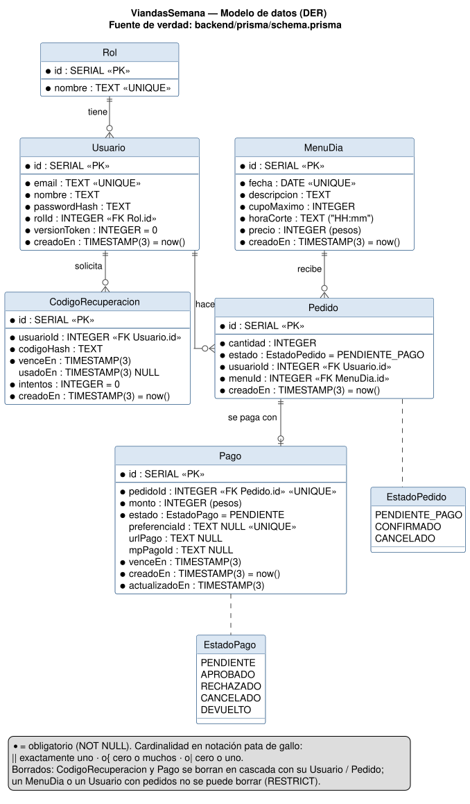

# Modelo de datos — DER (consigna 4.5)

La fuente de verdad es `backend/prisma/schema.prisma`; las tablas se crean con las migraciones de
`backend/prisma/migrations/` (`20261004183355_inicial` y `20261004200000_recuperacion_y_pagos`). El
DER refleja exactamente lo implementado en PostgreSQL: nombres de tablas y columnas, tipos SQL, claves y
restricciones.



## Cardinalidades

| Relación | Cardinalidad | Clave foránea | Al borrar el padre |
|---|---|---|---|
| Rol — Usuario | 1 : N (un rol tiene 0..N usuarios; un usuario tiene exactamente 1 rol) | `Usuario.rolId → Rol.id` | RESTRICT |
| Usuario — CodigoRecuperacion | 1 : N (0..N códigos por usuario) | `CodigoRecuperacion.usuarioId → Usuario.id` | CASCADE |
| Usuario — Pedido | 1 : N (0..N pedidos por usuario) | `Pedido.usuarioId → Usuario.id` | RESTRICT |
| MenuDia — Pedido | 1 : N (0..N pedidos por menú) | `Pedido.menuId → MenuDia.id` | RESTRICT |
| Pedido — Pago | 1 : 0..1 (un pedido tiene a lo sumo un pago) | `Pago.pedidoId → Pedido.id` (UNIQUE) | CASCADE |

## Diccionario de datos

### Rol

| Columna | Tipo | Restricciones | Descripción |
|---|---|---|---|
| `id` | SERIAL | PK | |
| `nombre` | TEXT | NOT NULL, UNIQUE | `COCINERO` o `CLIENTE` (los inserta la migración inicial) |

### Usuario

| Columna | Tipo | Restricciones | Descripción |
|---|---|---|---|
| `id` | SERIAL | PK | |
| `email` | TEXT | NOT NULL, UNIQUE | Se guarda en minúsculas |
| `nombre` | TEXT | NOT NULL | |
| `passwordHash` | TEXT | NOT NULL | Hash bcrypt (incluye la sal). Nunca la contraseña |
| `rolId` | INTEGER | NOT NULL, FK → `Rol.id` | |
| `versionToken` | INTEGER | NOT NULL, DEFAULT 0 | Sube en cada logout y al cambiar la contraseña: invalida los tokens anteriores |
| `creadoEn` | TIMESTAMP(3) | NOT NULL, DEFAULT now | |

### CodigoRecuperacion

| Columna | Tipo | Restricciones | Descripción |
|---|---|---|---|
| `id` | SERIAL | PK | |
| `usuarioId` | INTEGER | NOT NULL, FK → `Usuario.id`, índice | |
| `codigoHash` | TEXT | NOT NULL | HMAC-SHA256 del código de 6 dígitos. Nunca el código |
| `venceEn` | TIMESTAMP(3) | NOT NULL | 15 minutos después de creado |
| `usadoEn` | TIMESTAMP(3) | NULL | Se completa al usarlo, al reemplazarlo o al bloquearlo |
| `intentos` | INTEGER | NOT NULL, DEFAULT 0 | Intentos fallidos (máximo 5) |
| `creadoEn` | TIMESTAMP(3) | NOT NULL, DEFAULT now | Se usa para el límite de un código por minuto |

### MenuDia

| Columna | Tipo | Restricciones | Descripción |
|---|---|---|---|
| `id` | SERIAL | PK | |
| `fecha` | DATE | NOT NULL, UNIQUE | Un menú por día |
| `descripcion` | TEXT | NOT NULL | |
| `cupoMaximo` | INTEGER | NOT NULL | Viandas que se pueden cocinar ese día (≥ 1, lo valida la API) |
| `horaCorte` | TEXT | NOT NULL | "HH:mm", hora de Argentina |
| `precio` | INTEGER | NOT NULL | Pesos por vianda (≥ 1 al crear; 0 en menús anteriores a los pagos) |
| `creadoEn` | TIMESTAMP(3) | NOT NULL, DEFAULT now | |

### Pedido

| Columna | Tipo | Restricciones | Descripción |
|---|---|---|---|
| `id` | SERIAL | PK | |
| `cantidad` | INTEGER | NOT NULL | Viandas reservadas (≥ 1) |
| `estado` | `EstadoPedido` | NOT NULL, DEFAULT `PENDIENTE_PAGO` | `PENDIENTE_PAGO`, `CONFIRMADO` o `CANCELADO` |
| `usuarioId` | INTEGER | NOT NULL, FK → `Usuario.id` | Cliente que reservó |
| `menuId` | INTEGER | NOT NULL, FK → `MenuDia.id` | |
| `creadoEn` | TIMESTAMP(3) | NOT NULL, DEFAULT now | |

### Pago

| Columna | Tipo | Restricciones | Descripción |
|---|---|---|---|
| `id` | SERIAL | PK | |
| `pedidoId` | INTEGER | NOT NULL, UNIQUE, FK → `Pedido.id` | |
| `monto` | INTEGER | NOT NULL | Pesos: cantidad × precio |
| `estado` | `EstadoPago` | NOT NULL, DEFAULT `PENDIENTE` | `PENDIENTE`, `APROBADO`, `RECHAZADO`, `CANCELADO` o `DEVUELTO` |
| `preferenciaId` | TEXT | NULL, UNIQUE | Preferencia de Checkout Pro |
| `urlPago` | TEXT | NULL | `init_point` de la preferencia |
| `mpPagoId` | TEXT | NULL | Id del pago en Mercado Pago |
| `venceEn` | TIMESTAMP(3) | NOT NULL | Hasta cuándo se puede pagar |
| `creadoEn` | TIMESTAMP(3) | NOT NULL, DEFAULT now | |
| `actualizadoEn` | TIMESTAMP(3) | NOT NULL | Lo actualiza Prisma en cada cambio |

## Consultas para mostrar en vivo

```sql
-- Usuarios con su rol (la contraseña no se ve: sólo el hash)
SELECT u.id, u.email, r.nombre AS rol, left(u."passwordHash", 20) AS hash FROM "Usuario" u JOIN "Rol" r ON r.id = u."rolId";

-- Viandas reservadas por menú (lo que ocupa cupo)
SELECT m.fecha, m."cupoMaximo", COALESCE(SUM(p.cantidad) FILTER (WHERE p.estado IN ('PENDIENTE_PAGO','CONFIRMADO')), 0) AS reservadas
FROM "MenuDia" m LEFT JOIN "Pedido" p ON p."menuId" = m.id GROUP BY m.id ORDER BY m.fecha;

-- Pedidos con su pago
SELECT p.id, p.estado, p.cantidad, g.estado AS pago, g.monto, g."mpPagoId" FROM "Pedido" p LEFT JOIN "Pago" g ON g."pedidoId" = p.id ORDER BY p.id DESC;
```
