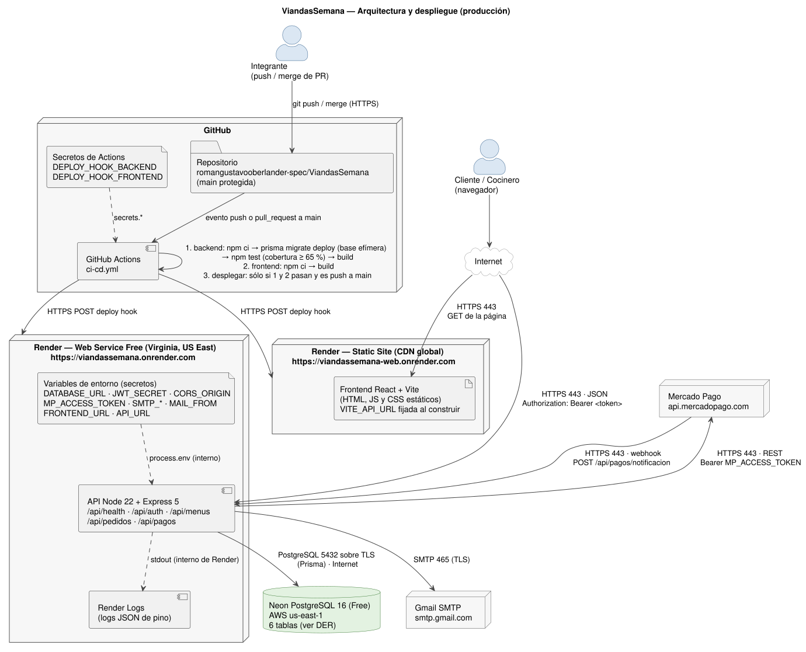
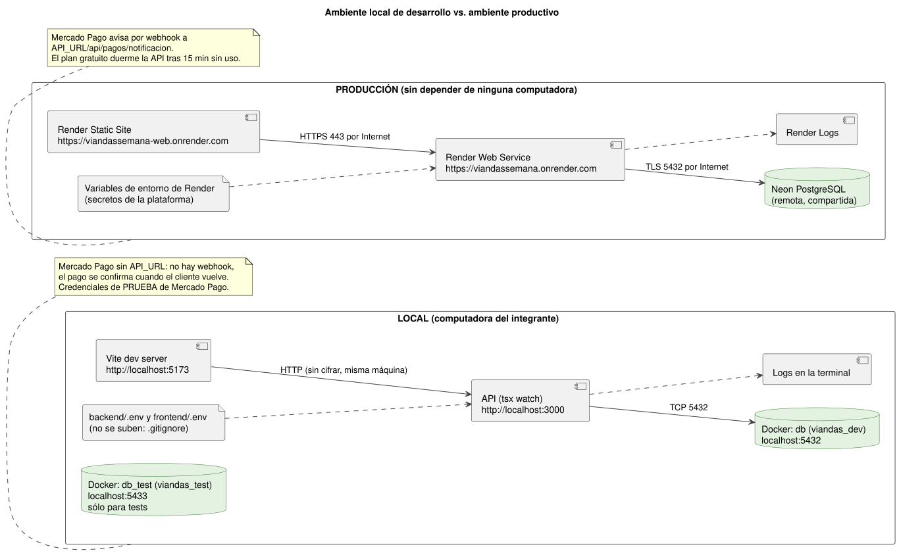

# Arquitectura y despliegue (consigna 4.6)

## 1. Componentes desplegables

| Componente | Tecnología | Plataforma | URL productiva |
|---|---|---|---|
| Cliente (frontend) | React 18 + Vite, sitio estático | Render Static Site (CDN global) | https://viandassemana-web.onrender.com |
| API (backend) | Node 22 + Express 5 + TypeScript + Prisma | Render Web Service, plan Free, Virginia (US East) | https://viandassemana.onrender.com/api/health |
| Base de datos | PostgreSQL 16 | Neon, plan Free, AWS us-east-1 | (privada: sólo con `DATABASE_URL`) |
| Pagos | Mercado Pago Checkout Pro | servicio externo | https://api.mercadopago.com |
| Correo | SMTP de Gmail (cuenta del proyecto) | servicio externo | smtp.gmail.com |
| Logs | Render Logs | Render | panel de Render del Web Service |
| Repositorio y CI/CD | GitHub + GitHub Actions | GitHub | https://github.com/romangustavooberlander-spec/ViandasSemana |

No hay caché ni cola de mensajes. El plan gratuito de Render duerme la API tras 15 minutos sin
tráfico; la primera petición posterior tarda alrededor de un minuto.

## 2. Comunicaciones

| Desde → hacia | Protocolo y puerto | ¿Atraviesa Internet? |
|---|---|---|
| Navegador → frontend (Render Static Site) | HTTPS, 443 | Sí |
| Navegador → API | HTTPS, 443, JSON, `Authorization: Bearer <token>` | Sí |
| API → Neon PostgreSQL | protocolo PostgreSQL sobre TLS, 5432 (Prisma) | Sí (Render y Neon son proveedores distintos) |
| API → Mercado Pago | HTTPS, 443, REST con `Bearer MP_ACCESS_TOKEN` | Sí |
| Mercado Pago → API (webhook) | HTTPS, 443, `POST /api/pagos/notificacion` | Sí |
| API → Gmail | SMTP con TLS, 465 | Sí |
| API → Render Logs | salida estándar del proceso | No (interno de Render) |
| Render → API | el balanceador de Render termina el HTTPS y reenvía al puerto de la variable `PORT` | No (interno de Render) |
| GitHub Actions → Render | HTTPS, 443, POST a los deploy hooks | Sí |

El frontend nunca habla con la base de datos: todo pasa por la API (consigna 3.1).

## 3. Secretos y su recorrido

| Secreto | Dónde se carga | Cómo llega al componente |
|---|---|---|
| `DATABASE_URL`, `JWT_SECRET`, `MP_ACCESS_TOKEN`, `SMTP_USER`, `SMTP_PASS` | Variables de entorno del Web Service en el panel de Render | Render las pone en `process.env` al iniciar → `backend/src/config/env.ts` (única lectura) → Prisma, `jsonwebtoken`, `lib/mercadoPago.ts`, `lib/mailer.ts` |
| `CORS_ORIGIN`, `FRONTEND_URL`, `API_URL`, `SMTP_HOST`, `SMTP_PORT`, `MAIL_FROM` | Ídem (configuración, no secretos) | Ídem |
| `VITE_API_URL` | Variable de entorno del Static Site en Render | Vite la escribe en el JavaScript **al construir** (es pública: sólo es la URL de la API) |
| `DEPLOY_HOOK_BACKEND`, `DEPLOY_HOOK_FRONTEND` | Secretos de GitHub Actions (Settings → Secrets and variables → Actions) | `${{ secrets.* }}` en el job `desplegar` de `ci-cd.yml` |
| Credenciales de la base de **tests** | Fijas en `vitest.config.ts` y `ci-cd.yml` | No son secretos: la base es efímera y local |

Ningún secreto está en el repositorio: `.env` está en `.gitignore` y `.env.example` sólo tiene nombres.
Los logs nunca incluyen el encabezado `Authorization` ni contraseñas (`redact` en `lib/logger.ts`).

## 4. Del push a producción

1. Un integrante sube una rama y abre un pull request a `main` (la rama `main` está protegida).
2. **Evento `pull_request`:** GitHub Actions corre los jobs `backend` y `frontend` (no despliega). El PR muestra si pasaron.
3. Se hace merge del PR. **Evento `push` a `main`:** se vuelve a correr el pipeline:
   - `backend`: `npm ci` → `npx prisma generate` → `npx prisma migrate deploy` contra una base PostgreSQL efímera del runner → `npm test` (tests unitarios + integración, falla si la cobertura de líneas es menor al 65 %) → sube el informe de cobertura → `npm run build`.
   - `frontend`: `npm ci` → `npm run build` (`tsc` + `vite build`).
4. **Sólo si los dos jobs pasaron**, el job `desplegar` hace `POST` a los deploy hooks de Render.
5. **Evento deploy hook:** Render descarga el commit de `main`, ejecuta el comando de build configurado en su panel y reemplaza la versión en línea (API y sitio estático).
6. El historial de ejecuciones queda en la pestaña **Actions** del repositorio (exitosas y fallidas, con el paso que falló).

## 5. Ambiente local vs. productivo

| Aspecto | Local | Producción |
|---|---|---|
| Frontend | `npm run dev`, http://localhost:5173 | Render Static Site, HTTPS |
| API | `npm run dev` (`tsx watch`), http://localhost:3000 | Render Web Service (`npm start`), HTTPS |
| Base de datos | Docker: `viandas_dev` en `localhost:5432` | Neon PostgreSQL remota y compartida |
| Base de tests | Docker: `viandas_test` en `localhost:5433` | Contenedor efímero en GitHub Actions |
| Configuración | archivos `.env` (no se suben) | variables de entorno de Render y secretos de GitHub |
| Mercado Pago | credenciales de prueba; sin `API_URL` no hay webhook y el pago se confirma cuando el cliente vuelve | `API_URL` pública: llega el webhook aunque el cliente cierre la pestaña |
| Logs | en la terminal | Render Logs |
| Cifrado | HTTP sin cifrar (misma máquina) | HTTPS con certificado válido de Render |

La diferencia entre ambientes se resuelve **sólo por configuración**: el mismo código corre en los dos.
