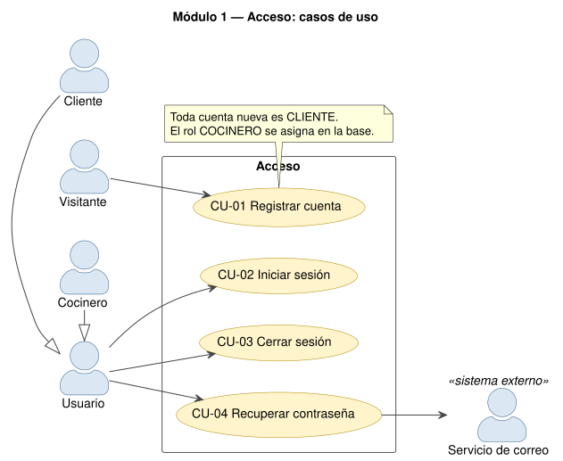
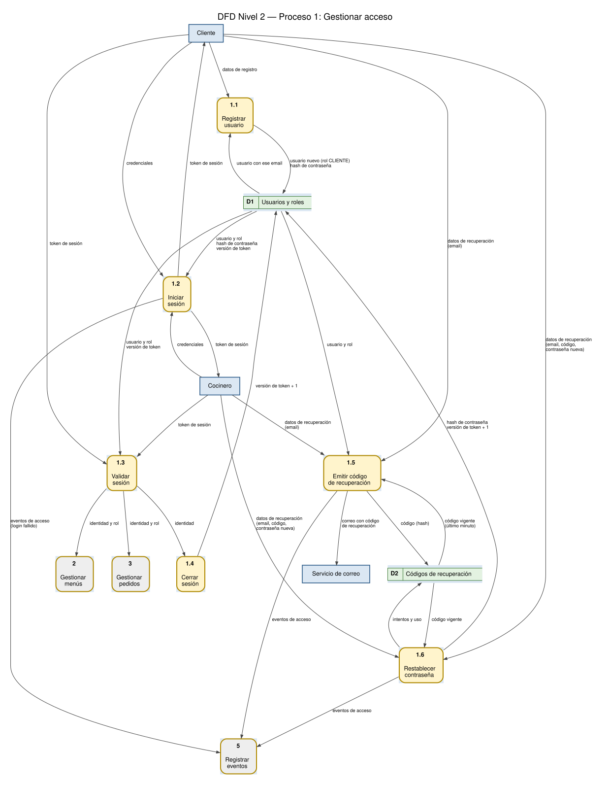

# Módulo 1 — Acceso

## 1. Propósito

Identifica a cada persona que usa el sistema y decide qué puede hacer. Cubre el registro, el inicio
y cierre de sesión, la validación del token en cada petición, los permisos por rol y la recuperación
de la contraseña por correo. Corresponde al **proceso 1 "Gestionar acceso"** de los DFD y a la
sección 3.4 de la consigna (autenticación y control de acceso).

| Rol | Cómo se obtiene | Qué puede hacer |
|---|---|---|
| `CLIENTE` | Todo registro crea un cliente | Ver menús, reservar y pagar, ver y cancelar **sus** pedidos |
| `COCINERO` | Se asigna en la base (por ejemplo con `npx prisma studio`) | Crear, modificar y borrar menús; ver **todos** los pedidos |

## 2. Dónde está en el código

| Capa | Archivo | Qué hace |
|---|---|---|
| Base de datos | `backend/prisma/schema.prisma` (modelos `Rol`, `Usuario`, `CodigoRecuperacion`) | Tablas del módulo. La migración inicial inserta los roles |
| API | `backend/src/routes/auth.ts` | Endpoints de registro, login, logout, `/yo` y recuperación |
| API | `backend/src/middleware/auth.ts` | `autenticar` (401) y `exigirRol(...)` (403), usados por los demás módulos |
| API | `backend/src/lib/mailer.ts` | Envío de correos por SMTP (Nodemailer) |
| Frontend | `frontend/src/pantallas/Acceso.tsx` | Ingresar / crear cuenta |
| Frontend | `frontend/src/pantallas/Recuperar.tsx` | Los tres pasos de la recuperación |
| Frontend | `frontend/src/api/cliente.ts` | Guarda la sesión en `localStorage` y manda `Authorization: Bearer` |
| Frontend | `frontend/src/App.tsx` | Ante un 401 vuelve a la pantalla de ingreso; botón "Salir" |
| Tests | `backend/tests/integration/auth.test.ts`, `recuperacion.test.ts`, `tests/unit/mailer.test.ts` | 11 + 7 tests de integración y 1 unitario |

## 3. Casos de uso



### CU-01 Registrar cuenta

| Campo | Detalle |
|---|---|
| **Módulo** | 1 — Acceso |
| **Actor principal** | Visitante (persona sin cuenta) |
| **Actores secundarios** | — |
| **Descripción** | El visitante crea su cuenta y queda con la sesión iniciada como cliente. |
| **Precondiciones** | No existe un usuario con el email ingresado. |
| **Disparador** | El visitante elige "Crear cuenta" en la pantalla de ingreso. |
| **Endpoint** | `POST /api/auth/registro` → `201` |

**Flujo principal**

1. El visitante completa nombre, email y contraseña y confirma.
2. El frontend envía los datos a `POST /api/auth/registro`.
3. La API valida los datos con zod: nombre no vacío, email válido (se pasa a minúsculas), contraseña de 8 a 72 caracteres.
4. La API verifica que el email no esté registrado.
5. La API calcula el hash de la contraseña con bcrypt (10 rondas, la sal va incluida en el hash).
6. La API guarda el usuario con el rol `CLIENTE` y responde `201` con id, nombre, email y rol.
7. El frontend inicia sesión automáticamente con los mismos datos (CU-02) y muestra el menú de la semana.

**Flujos alternativos**

- **3a. Datos inválidos:** la API responde `400` con la lista de campos y mensajes; el frontend muestra el mensaje y el visitante corrige.
- **4a. Email ya registrado:** la API responde `409 "Ya existe un usuario con ese email"`; no se crea nada.

**Postcondiciones:** existe un `Usuario` nuevo con rol `CLIENTE` y `passwordHash` (nunca la contraseña en texto plano). El visitante queda con sesión iniciada.

**Reglas:** nadie puede registrarse como cocinero desde la API: el rol se asigna en la base.

### CU-02 Iniciar sesión

| Campo | Detalle |
|---|---|
| **Módulo** | 1 — Acceso |
| **Actor principal** | Usuario (Cliente o Cocinero) |
| **Precondiciones** | El usuario tiene cuenta. |
| **Disparador** | El usuario completa "Ingresar". |
| **Endpoint** | `POST /api/auth/login` → `200 { token, usuario }` |

**Flujo principal**

1. El usuario ingresa email y contraseña.
2. La API valida el formato (zod) y busca el usuario por email, con su rol.
3. La API compara la contraseña con el hash usando `bcrypt.compare`.
4. La API firma un JWT con `{ id, v }` (`v` = `versionToken` actual del usuario) que vence a las **8 horas**.
5. La API responde el token y los datos públicos del usuario (id, nombre, rol).
6. El frontend guarda la sesión en `localStorage` y muestra las pestañas que corresponden al rol.

**Flujos alternativos**

- **2a / 3a. Email inexistente o contraseña incorrecta:** la API responde `401 "Email o contraseña incorrectos"` (el mismo mensaje en los dos casos, para no revelar qué cuentas existen) y registra el evento `login_fallido` en el log.
- **2b. Datos con formato inválido:** `400`.

**Postcondiciones:** el usuario tiene un token válido; cada petición posterior lo manda en `Authorization: Bearer <token>`.

### CU-03 Cerrar sesión

| Campo | Detalle |
|---|---|
| **Módulo** | 1 — Acceso |
| **Actor principal** | Usuario (Cliente o Cocinero) |
| **Precondiciones** | El usuario tiene la sesión iniciada. |
| **Disparador** | El usuario toca "Salir". |
| **Endpoint** | `POST /api/auth/logout` → `204` |

**Flujo principal**

1. El frontend llama a `POST /api/auth/logout` con el token.
2. La API valida el token (`autenticar`).
3. La API incrementa `versionToken` del usuario: **todos** los tokens emitidos antes dejan de valer, en cualquier dispositivo.
4. La API responde `204`; el frontend borra la sesión guardada y vuelve a la pantalla de ingreso.

**Flujos alternativos**

- **2a. Token ya inválido o vencido:** la API responde `401`; el frontend igual borra la sesión local.

**Postcondiciones:** el token anterior responde `401 "La sesión ya no es válida"` si se vuelve a usar.

### CU-04 Recuperar contraseña

| Campo | Detalle |
|---|---|
| **Módulo** | 1 — Acceso |
| **Actor principal** | Usuario (Cliente o Cocinero) |
| **Actores secundarios** | Servicio de correo (SMTP de Gmail) |
| **Precondiciones** | El usuario tiene acceso a la casilla de su email. |
| **Disparador** | El usuario toca "¿Olvidaste tu contraseña?". |
| **Endpoints** | `POST /api/auth/recuperar`, `POST /api/auth/recuperar/verificar`, `POST /api/auth/recuperar/cambiar` |

**Flujo principal**

1. El usuario ingresa su email.
2. La API busca el usuario y verifica que no se haya pedido un código en el último minuto.
3. La API genera un código aleatorio de 6 dígitos (`crypto.randomInt`), invalida los códigos anteriores y guarda **sólo el HMAC** del código, con vencimiento a los 15 minutos.
4. La API envía el código por correo (Servicio de correo) y responde siempre el mismo mensaje: "Si el email está registrado, te enviamos un código".
5. El usuario ingresa el código; la API lo verifica (`/verificar`).
6. El usuario elige la contraseña nueva (8 a 72 caracteres) y confirma (`/cambiar`).
7. La API vuelve a verificar el código y, en una transacción, lo marca como usado **sólo si nadie lo usó antes**, guarda el hash bcrypt de la contraseña nueva e incrementa `versionToken` (se cierran las sesiones abiertas).
8. La API registra `password_restablecida` y responde; el usuario ingresa con la contraseña nueva (CU-02).

**Flujos alternativos**

- **2a. Email no registrado:** no se envía nada, pero la respuesta es la misma (no revela quién tiene cuenta).
- **2b. Ya se pidió un código hace menos de un minuto:** no se envía otro; la respuesta es la misma.
- **4a. El servidor de correo no está configurado o falla:** `503` "No pudimos enviar el correo. Probá de nuevo en unos minutos" y evento `correo_fallido` / `correo_sin_configurar` en el log.
- **5a. Código incorrecto:** `400 CODIGO_INCORRECTO` y suma un intento. Al 5.º intento fallido el código se invalida: `400 CODIGO_BLOQUEADO`.
- **5b. Código vencido:** `400 CODIGO_VENCIDO`.
- **5c. Código ya usado o reemplazado por uno nuevo:** `400 CODIGO_USADO`.
- **7a. Dos pedidos simultáneos con el mismo código:** sólo uno logra marcarlo como usado; el otro recibe `400 CODIGO_USADO`.

**Postcondiciones:** la contraseña anterior deja de funcionar, el código no se puede volver a usar y los tokens anteriores dan `401`.

## 4. DFD Nivel 2 — Proceso 1 "Gestionar acceso"



| N.º | Proceso | Entrada | Salida | Almacenes |
|---|---|---|---|---|
| 1.1 | Registrar usuario | datos de registro | usuario nuevo | D1 (lee el email, escribe el usuario) |
| 1.2 | Iniciar sesión | credenciales | token de sesión; evento `login_fallido` | D1 (lee) |
| 1.3 | Validar sesión | token de sesión | identidad y rol → procesos 2, 3 y 1.4 | D1 (lee `versionToken` y rol) |
| 1.4 | Cerrar sesión | identidad | — | D1 (escribe `versionToken + 1`) |
| 1.5 | Emitir código de recuperación | email | correo con código | D1 (lee), D2 (lee el último, escribe el nuevo) |
| 1.6 | Restablecer contraseña | email, código y contraseña nueva | — | D2 (intentos y uso), D1 (hash y `versionToken`) |

El proceso 1.3 es el middleware `autenticar`: se ejecuta antes de **cada** endpoint protegido y es
el que entrega la identidad a los procesos 2 y 3. El rol se lee **de la base**, nunca del cliente.

## 5. Datos que usa

| Tabla | Campos clave | Notas |
|---|---|---|
| `Rol` | `id`, `nombre` (único) | Sólo dos filas: `COCINERO` y `CLIENTE` (las crea la migración) |
| `Usuario` | `email` (único), `passwordHash`, `rolId`, `versionToken` | `versionToken` sube en cada logout y al restablecer la contraseña |
| `CodigoRecuperacion` | `codigoHash`, `venceEn`, `usadoEn`, `intentos` | Se borra en cascada con el usuario |

## 6. API

| Método | Ruta | Protección | Respuestas |
|---|---|---|---|
| POST | `/api/auth/registro` | pública | 201, 400, 409 |
| POST | `/api/auth/login` | pública | 200, 400, 401 |
| POST | `/api/auth/logout` | token | 204, 401 |
| GET | `/api/auth/yo` | token | 200 `{ id, rol }`, 401 |
| POST | `/api/auth/recuperar` | pública | 200 (siempre el mismo mensaje), 400, 503 |
| POST | `/api/auth/recuperar/verificar` | pública | 200, 400 |
| POST | `/api/auth/recuperar/cambiar` | pública | 200, 400 |

**Cómo se protege cualquier endpoint de otro módulo:**

```ts
menusRouter.use(autenticar);                         // 401 sin token, vencido o cerrado
menusRouter.post('/', exigirRol('COCINERO'), ...);   // 403 si el rol no corresponde
```

## 7. Reglas y validaciones (dónde está cada una)

| Regla | Dónde |
|---|---|
| Email válido y en minúsculas, contraseña de 8 a 72 caracteres | `esquemaEmail` / `esquemaPassword` (zod) en `routes/auth.ts` |
| Contraseña guardada con hash y sal (bcrypt) | `routes/auth.ts`, registro y `/recuperar/cambiar` |
| Token sólo por encabezado `Authorization` (nunca en la URL) | `middleware/auth.ts`; el logger oculta ese encabezado (`redact`) |
| El id del usuario sale del token, no de un parámetro | `autenticar` → `req.usuario` |
| Token inválido tras logout | comparación `usuario.versionToken !== datos.v` en `autenticar` |
| Un código por minuto, 15 minutos de validez, 5 intentos, un solo uso | constantes al principio de la sección de recuperación en `routes/auth.ts` |
| La respuesta de `/recuperar` no revela si el email existe | `routes/auth.ts` |

## 8. Pantallas

| Pantalla | Qué muestra |
|---|---|
| Ingresar / Crear cuenta (`Acceso.tsx`) | Formulario con pestañas; tras registrarse entra solo |
| Recuperar contraseña (`Recuperar.tsx`) | Paso 1: email · Paso 2: código · Paso 3: contraseña nueva; botón para pedir otro código |
| Encabezado (`App.tsx`) | Nombre, rol ("Cocina" o "Cliente") y botón "Salir" |

Si cualquier petición devuelve `401`, el frontend borra la sesión y muestra "Tu sesión venció. Ingresá de nuevo."

## 9. Tests que lo cubren

- `auth.test.ts`: registro correcto con la contraseña hasheada (201), datos inválidos (400), email duplicado (409), login correcto y con contraseña incorrecta (401), petición sin token, con token inválido y con token vencido (401), cliente en una ruta de cocinero (403), cocinero que pasa porque el rol se lee de la base, y token que deja de valer después del logout (401).
- `recuperacion.test.ts`: flujo completo, misma respuesta para un email inexistente, código incorrecto con bloqueo a los 5 intentos, código vencido, código nuevo que invalida el anterior y límite de uno por minuto, validación de la contraseña nueva (400) y correo que no se puede mandar (503).
- `mailer.test.ts`: el envío de correo sin SMTP configurado responde 503.

## 10. Para modificarlo

| Si piden… | Tocar |
|---|---|
| Un campo nuevo del usuario (por ejemplo, teléfono) | `schema.prisma` + migración → `esquemaRegistro` en `routes/auth.ts` → formulario de `Acceso.tsx` |
| Cambiar la duración de la sesión | `expiresIn: '8h'` en `routes/auth.ts` |
| Un rol nuevo | fila en la tabla `Rol` (migración) y `exigirRol('NUEVO_ROL')` en las rutas |
| Más exigencia en la contraseña | `esquemaPassword` en `routes/auth.ts` (el mensaje de error sale solo en el 400) |
