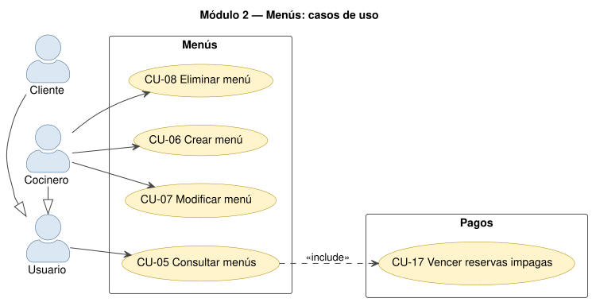
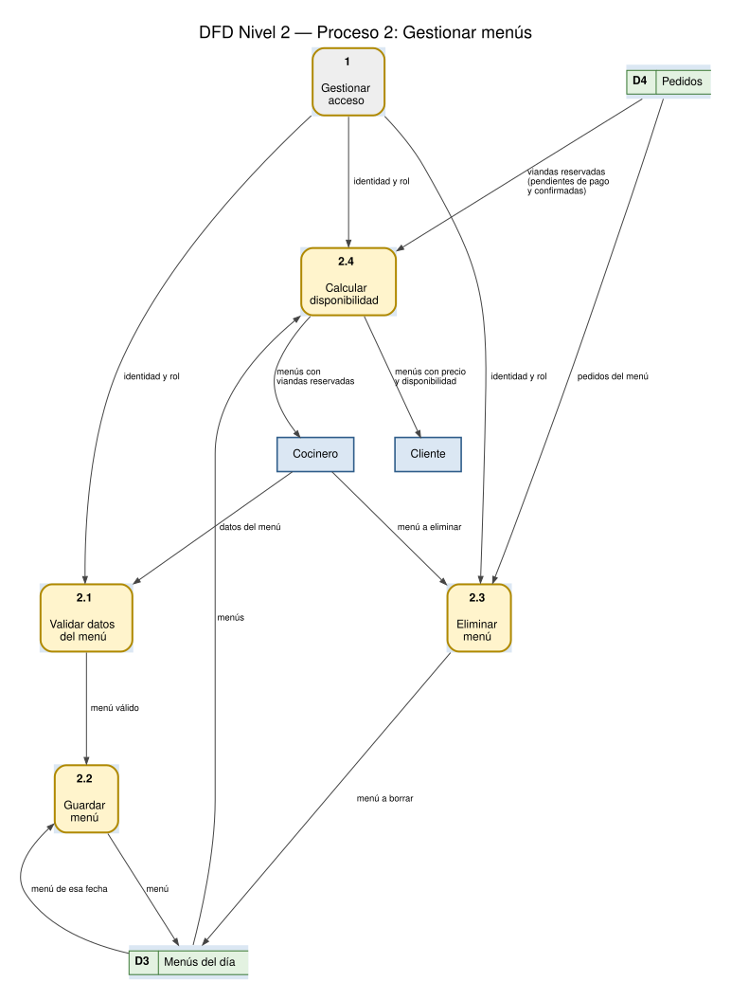

# Módulo 2 — Menús

## 1. Propósito

Permite que quien cocina publique el menú de cada día con su **cupo máximo**, su **horario de corte**
y su **precio**, y que todos los usuarios vean los menús con cuántas viandas quedan. Corresponde al
**proceso 2 "Gestionar menús"** de los DFD.

La API calcula y devuelve en cada menú `reservadas`, `disponibles` y `abierto` (si todavía se puede
reservar). El frontend no calcula ninguna regla: sólo muestra lo que recibe (consigna 3.2).

## 2. Dónde está en el código

| Capa | Archivo | Qué hace |
|---|---|---|
| Base de datos | `backend/prisma/schema.prisma` (modelo `MenuDia`) | Tabla de menús |
| API | `backend/src/routes/menus.ts` | CRUD de menús y cálculo de disponibilidad (`conTotales`) |
| Reglas | `backend/src/domain/reglasPedido.ts` (`yaPasoElCorte`, `instanteDeCorte`) | Si ya pasó la hora de corte (hora de Argentina, UTC-3) |
| Reglas | `backend/src/lib/pagos.ts` (`OCUPAN_CUPO`, `vencerReservasImpagas`) | Qué pedidos ocupan cupo y liberación de reservas vencidas |
| Frontend | `frontend/src/pantallas/Menus.tsx` | Tarjetas de menús, formulario del cocinero, botón "Reservar y pagar" |
| Tests | `backend/tests/integration/menus.test.ts` | 10 tests de integración |

## 3. Casos de uso



### CU-05 Consultar menús

| Campo | Detalle |
|---|---|
| **Módulo** | 2 — Menús |
| **Actor principal** | Usuario (Cliente o Cocinero) |
| **Precondiciones** | El usuario tiene la sesión iniciada (CU-02). |
| **Disparador** | El usuario abre la pestaña "Menú de la semana" / "Menús de la semana". |
| **Relaciones** | `<<include>>` CU-17 Vencer reservas impagas |
| **Endpoints** | `GET /api/menus`, `GET /api/menus/:id` |

**Flujo principal**

1. El frontend pide `GET /api/menus` con el token.
2. La API valida la sesión (proceso 1.3).
3. La API cancela las reservas cuyo plazo para pagar ya venció (CU-17), para que no ocupen cupo.
4. La API lee los menús ordenados por fecha y, para cada uno, suma las viandas de pedidos `PENDIENTE_PAGO` y `CONFIRMADO`.
5. La API devuelve cada menú con `reservadas`, `disponibles = cupoMaximo − reservadas` (nunca negativo) y `abierto` (tiene precio y no pasó la hora de corte).
6. El frontend muestra una tarjeta por día con el precio, las viandas reservadas sobre el cupo y la hora de corte. Al cliente le agrega el botón "Reservar y pagar" si `abierto` es verdadero y quedan viandas; al cocinero, los botones para editar y borrar.

**Flujos alternativos**

- **2a. Sin sesión o sesión vencida:** `401`; el frontend vuelve a la pantalla de ingreso.
- **4a. Menú pedido por id que no existe:** `404 "Menú no encontrado"`.
- **6a. "Ver días anteriores":** por defecto se ocultan los días pasados; el interruptor los muestra.

**Postcondiciones:** ninguna en los datos de menús; sólo se liberan reservas vencidas.

### CU-06 Crear menú

| Campo | Detalle |
|---|---|
| **Módulo** | 2 — Menús |
| **Actor principal** | Cocinero |
| **Precondiciones** | Sesión iniciada con rol `COCINERO`. |
| **Disparador** | El cocinero toca "Nuevo menú". |
| **Endpoint** | `POST /api/menus` → `201` |

**Flujo principal**

1. El cocinero completa fecha, descripción, cupo máximo, precio y hora de corte.
2. La API verifica el rol (`exigirRol('COCINERO')`).
3. La API valida con zod: fecha `AAAA-MM-DD`, descripción no vacía, cupo entero ≥ 1, precio entero ≥ 1 (pesos, sin centavos) y hora `HH:mm` de 00:00 a 23:59.
4. La API verifica que no exista otro menú para esa fecha.
5. La API guarda el menú y responde `201` con el menú y sus totales (0 reservadas).
6. El frontend muestra "Menú creado" y lo agrega a la lista.

**Flujos alternativos**

- **2a. Usuario con rol CLIENTE:** `403 "No tenés permiso para esta acción"`.
- **3a. Datos inválidos:** `400` con el campo y el mensaje (por ejemplo "Formato HH:mm").
- **4a. Ya existe un menú para esa fecha:** `409`.

**Postcondiciones:** existe un `MenuDia` nuevo y los clientes lo ven abierto hasta la hora de corte.

### CU-07 Modificar menú

| Campo | Detalle |
|---|---|
| **Módulo** | 2 — Menús |
| **Actor principal** | Cocinero |
| **Precondiciones** | Sesión con rol `COCINERO`; el menú existe. |
| **Disparador** | El cocinero toca "Editar" en un menú. |
| **Endpoint** | `PUT /api/menus/:id` → `200` |

**Flujo principal**

1. El frontend abre el formulario con los datos actuales; el cocinero los cambia y guarda.
2. La API verifica el rol y valida los datos igual que en CU-06.
3. La API verifica que el menú exista y que la nueva fecha no la use otro menú.
4. La API actualiza el menú y lo devuelve con sus totales recalculados.

**Flujos alternativos**

- **2a. Rol CLIENTE:** `403`. **2b. Datos inválidos:** `400`.
- **3a. El menú no existe:** `404`. **3b. La fecha ya la tiene otro menú:** `409`.

**Postcondiciones:** el menú queda con los datos nuevos. Si se baja el cupo por debajo de lo reservado,
`disponibles` queda en 0 (nunca negativo) y no se aceptan más pedidos; las reservas existentes se mantienen.

### CU-08 Eliminar menú

| Campo | Detalle |
|---|---|
| **Módulo** | 2 — Menús |
| **Actor principal** | Cocinero |
| **Precondiciones** | Sesión con rol `COCINERO`; el menú existe y **no tiene pedidos**. |
| **Disparador** | El cocinero toca "Borrar" y confirma. |
| **Endpoint** | `DELETE /api/menus/:id` → `204` |

**Flujo principal**

1. El frontend pide confirmación ("¿Borrar el menú del …?").
2. La API verifica el rol y que el menú exista.
3. La API cuenta los pedidos del menú (de cualquier estado); si no hay, lo borra y responde `204`.

**Flujos alternativos**

- **1a. El cocinero no confirma:** no se envía nada.
- **2a. Rol CLIENTE:** `403`. **2b. No existe:** `404`.
- **3a. El menú tiene pedidos:** `409 "No se puede borrar un menú que tiene pedidos"` (además, la clave foránea es `RESTRICT`).

**Postcondiciones:** el menú deja de existir.

## 4. DFD Nivel 2 — Proceso 2 "Gestionar menús"



| N.º | Proceso | Entrada | Salida | Almacenes |
|---|---|---|---|---|
| 2.1 | Validar datos del menú | datos del menú, identidad y rol | menú válido | — |
| 2.2 | Guardar menú | menú válido | — | D3 (lee la fecha, escribe el menú) |
| 2.3 | Eliminar menú | menú a eliminar, identidad y rol | — | D4 (lee sus pedidos), D3 (borra) |
| 2.4 | Calcular disponibilidad | identidad y rol | menús con precio y disponibilidad (cliente), menús con viandas reservadas (cocinero) | D3 (lee), D4 (suma viandas) |

## 5. Datos que usa

| Tabla | Campos | Notas |
|---|---|---|
| `MenuDia` | `fecha` (DATE, única), `descripcion`, `cupoMaximo`, `horaCorte` ("HH:mm"), `precio` (pesos) | Un menú por día |
| `Pedido` (lectura) | `menuId`, `cantidad`, `estado` | Ocupan cupo los estados `PENDIENTE_PAGO` y `CONFIRMADO` |

## 6. API

| Método | Ruta | Rol | Respuestas |
|---|---|---|---|
| GET | `/api/menus` | cualquiera con sesión | 200, 401 |
| GET | `/api/menus/:id` | cualquiera con sesión | 200, 400, 401, 404 |
| POST | `/api/menus` | COCINERO | 201, 400, 401, 403, 409 |
| PUT | `/api/menus/:id` | COCINERO | 200, 400, 401, 403, 404, 409 |
| DELETE | `/api/menus/:id` | COCINERO | 204, 400, 401, 403, 404, 409 |

Ejemplo de respuesta de `GET /api/menus`:

```json
[{ "id": 3, "fecha": "2026-10-15T00:00:00.000Z", "descripcion": "Milanesa con puré",
   "cupoMaximo": 20, "horaCorte": "10:00", "precio": 6500,
   "reservadas": 12, "disponibles": 8, "abierto": true }]
```

## 7. Reglas y validaciones

| Regla | Dónde |
|---|---|
| Formato de fecha, hora de corte, cupo y precio | `esquemaMenu` (zod) en `routes/menus.ts` |
| Un menú por fecha | índice único `MenuDia_fecha_key` + control previo (409) en `routes/menus.ts` |
| La hora de corte es hora de Argentina (UTC-3, sin horario de verano) | `instanteDeCorte` en `domain/reglasPedido.ts` |
| Un menú sin precio (precio 0, menús anteriores a los pagos) no se puede reservar | `abierto` en `conTotales` y control `SIN_PRECIO` en `routes/pedidos.ts` |
| No se borra un menú con pedidos | `routes/menus.ts` (409) y FK `ON DELETE RESTRICT` |

## 8. Pantallas

| Pantalla | Cliente | Cocinero |
|---|---|---|
| Menú de la semana (`Menus.tsx`) | Tarjeta por día con etiqueta "Quedan N", "Agotado" o "Cerrado", descripción, precio, barra de cupo, hora de corte, cantidad y "Reservar y pagar" (sólo si está abierto y quedan viandas) | La misma tarjeta, con "Editar" y "Borrar"; botón "Nuevo menú" con formulario |

## 9. Tests que lo cubren (`menus.test.ts`)

Crear (201), listar y ver uno, modificar, eliminar, no borrar con pedidos (409), no repetir fecha (409),
datos inválidos (400), menú inexistente (404), sin token (401) y cliente que intenta crear (403).

## 10. Para modificarlo

| Si piden… | Tocar |
|---|---|
| Un campo nuevo del menú (por ejemplo "es vegetariano") | `schema.prisma` + `npx prisma migrate dev` → `esquemaMenu` en `routes/menus.ts` → `tipos.ts` y formulario/tarjeta en `Menus.tsx` |
| Filtrar menús por fecha | parámetros de consulta en `menusRouter.get('/')` (`where` de `findMany`) |
| Un total (por ejemplo viandas reservadas de la semana) | nuevo endpoint en `routes/menus.ts` con `prisma.pedido.aggregate` sobre `OCUPAN_CUPO` |
