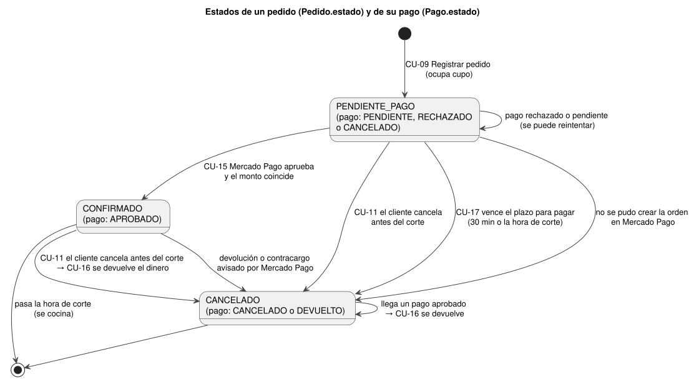
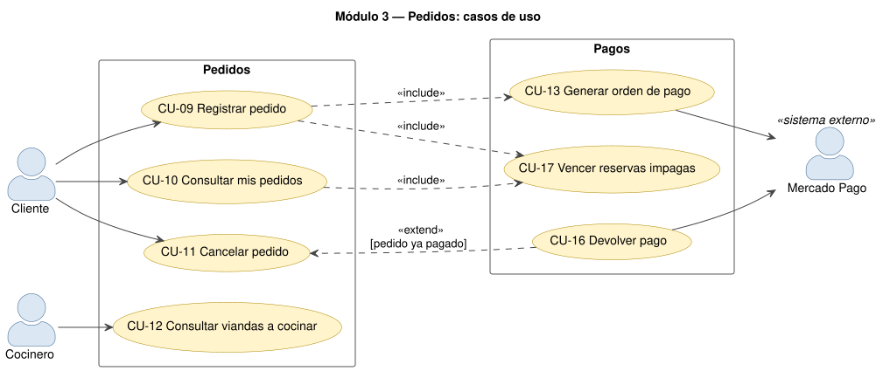
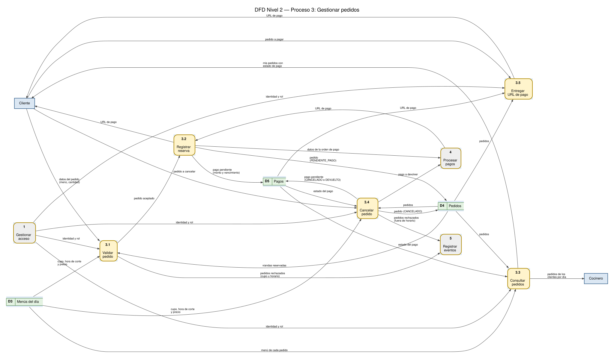

# Módulo 3 — Pedidos

## 1. Propósito

Es el corazón del negocio: el cliente reserva viandas de un menú, ve sus reservas y las cancela;
quien cocina ve cuántas viandas tiene que preparar cada día. Aplica las reglas de la propuesta en el
servidor: **cupo máximo**, **horario de corte para pedir** y **para cancelar**, y **permisos por rol**.
Corresponde al **proceso 3 "Gestionar pedidos"** de los DFD.

Un pedido nace `PENDIENTE_PAGO` y ocupa su lugar en el cupo mientras se paga (ver el módulo 4).

## 2. Dónde está en el código

| Capa | Archivo | Qué hace |
|---|---|---|
| Base de datos | `backend/prisma/schema.prisma` (modelo `Pedido`, enum `EstadoPedido`) | Tabla de pedidos |
| API | `backend/src/routes/pedidos.ts` | Crear (con transacción y bloqueo), listar, pagar y cancelar |
| Reglas (funciones puras) | `backend/src/domain/reglasPedido.ts` | `validarNuevoPedido`, `validarCancelacion`, `cuposDisponibles`, `vencimientoDelPago` |
| Pagos | `backend/src/lib/mercadoPago.ts`, `backend/src/lib/pagos.ts` | Orden de pago, devoluciones y vencimiento (módulo 4) |
| Frontend | `frontend/src/pantallas/Menus.tsx` (`reservar`) | Botón "Reservar y pagar" |
| Frontend | `frontend/src/pantallas/Pedidos.tsx` | "Mis pedidos" (cliente) y "Pedidos a cocinar" (cocinero) |
| Tests | `backend/tests/unit/reglasPedido.test.ts`, `backend/tests/integration/pedidos.test.ts` | 19 unitarios y 11 de integración |

## 3. Casos de uso

### CU-09 Registrar pedido ★ (caso de uso principal)

| Campo | Detalle |
|---|---|
| **Módulo** | 3 — Pedidos |
| **Actor principal** | Cliente |
| **Actores secundarios** | Mercado Pago (a través de CU-13) |
| **Descripción** | El cliente reserva una o más viandas de un menú; la reserva queda pendiente de pago y el cliente pasa a pagar en Mercado Pago. |
| **Precondiciones** | Sesión iniciada con rol `CLIENTE`. El menú existe, tiene precio y está abierto. |
| **Disparador** | El cliente elige la cantidad y toca "Reservar y pagar" en la tarjeta de un menú. |
| **Relaciones** | `<<include>>` CU-17 Vencer reservas impagas · `<<include>>` CU-13 Generar orden de pago |
| **Endpoint** | `POST /api/pedidos` `{ menuId, cantidad }` → `201 { ...pedido, pago, urlPago }` |

**Flujo principal**

1. El cliente indica la cantidad y toca "Reservar y pagar".
2. El frontend envía `POST /api/pedidos` con el token.
3. La API valida la sesión y que el rol sea `CLIENTE`.
4. La API valida los datos con zod (`menuId` entero positivo, `cantidad` entero ≥ 1).
5. La API abre una transacción y **bloquea la fila del menú** (`SELECT … FOR UPDATE`): si llegan dos pedidos a la vez, el segundo espera al primero.
6. La API verifica que el menú tenga precio.
7. La API cancela las reservas impagas vencidas (CU-17) para que no ocupen cupo.
8. La API suma las viandas de los pedidos `PENDIENTE_PAGO` y `CONFIRMADO` del menú.
9. La API aplica `validarNuevoPedido`: la hora de corte no pasó y la cantidad no supera las viandas disponibles.
10. La API crea el pedido (`PENDIENTE_PAGO`) y su pago (`PENDIENTE`, `monto = cantidad × precio`, vencimiento = 30 minutos o la hora de corte, lo que ocurra antes) y confirma la transacción.
11. La API genera la orden de pago en Mercado Pago (CU-13), guarda su id y la URL de pago.
12. La API responde `201` con el pedido, el pago y `urlPago`.
13. El frontend avisa "Te llevamos a Mercado Pago para pagar tu reserva…" y redirige al cliente a `urlPago` (continúa en CU-14).

**Flujos alternativos**

- **3a. Sin sesión:** `401`. **3b. Rol COCINERO:** `403`.
- **4a. Datos inválidos:** `400` con el detalle por campo.
- **5a. El menú no existe:** `404 "Menú no encontrado"`; se deshace la transacción.
- **6a. Menú sin precio:** `409 SIN_PRECIO "Este menú todavía no tiene precio"`.
- **9a. Pasó la hora de corte:** `409 FUERA_DE_HORARIO`; se registra el evento `regla_negocio` en el log.
- **9b. No alcanza el cupo:** `409 CUPO_COMPLETO` con "No quedan viandas disponibles para este día" o "Sólo quedan N viandas"; se registra `regla_negocio`.
- **11a. Mercado Pago no responde, falla o no está configurado:** el pedido y su pago pasan a `CANCELADO` (libera el cupo) y la API responde `502`/`503` con "Probá de nuevo en unos minutos"; el error queda en el log.

**Postcondiciones**

- Éxito: existe un `Pedido` `PENDIENTE_PAGO` con su `Pago` `PENDIENTE` y la URL de pago; las viandas quedan apartadas del cupo hasta que se pague, se cancele o venza.
- Fracaso: no queda ninguna reserva ocupando cupo.

**Reglas de negocio:** cupo máximo por día; no se pide después de la hora de corte; dos pedidos
simultáneos nunca superan el cupo (bloqueo de fila + transacción).

### CU-10 Consultar mis pedidos

| Campo | Detalle |
|---|---|
| **Módulo** | 3 — Pedidos |
| **Actor principal** | Cliente |
| **Precondiciones** | Sesión iniciada con rol `CLIENTE`. |
| **Disparador** | El cliente abre la pestaña "Mis pedidos" (o vuelve de Mercado Pago). |
| **Relaciones** | `<<include>>` CU-17 Vencer reservas impagas |
| **Endpoint** | `GET /api/pedidos` → `200` |

**Flujo principal**

1. El frontend pide `GET /api/pedidos`.
2. La API valida la sesión y cancela las reservas vencidas (CU-17).
3. La API lee **sólo los pedidos del usuario del token**, con su menú y el estado y monto de su pago, del más nuevo al más viejo.
4. La API agrega a cada pedido `cancelable` (no está cancelado y no pasó la hora de corte) y `pagable` (está `PENDIENTE_PAGO`).
5. El frontend agrupa los pedidos por día y muestra cada uno con su estado ("Pagado", "Falta pagar", "Pago rechazado", "Cancelado"…) y los botones "Pagar $…" y "Cancelar" según `pagable` y `cancelable`.

**Flujos alternativos**

- **2a. Sin sesión:** `401`.
- **5a. Sin pedidos:** "No tenés pedidos. Reservá desde el menú de la semana."
- **5b. "Ver días anteriores":** muestra también los pedidos de días pasados.

**Postcondiciones:** ninguna (sólo se liberan reservas vencidas).

### CU-11 Cancelar pedido ★ (caso de uso principal)

| Campo | Detalle |
|---|---|
| **Módulo** | 3 — Pedidos |
| **Actor principal** | Cliente |
| **Actores secundarios** | Mercado Pago (si hay que devolver el dinero) |
| **Descripción** | El cliente cancela una reserva propia antes de la hora de corte; si ya estaba pagada, se le devuelve el dinero. |
| **Precondiciones** | Sesión con rol `CLIENTE`; el pedido es del cliente y no está cancelado. |
| **Disparador** | El cliente toca "Cancelar" en "Mis pedidos" y confirma. |
| **Relaciones** | Extendido por CU-16 Devolver pago `[pedido ya pagado]` |
| **Endpoint** | `PATCH /api/pedidos/:id/cancelar` → `200` |

**Flujo principal**

1. El frontend pide confirmación; si el pedido está pagado agrega "Te devolvemos el pago por Mercado Pago".
2. El frontend envía `PATCH /api/pedidos/:id/cancelar`.
3. La API valida la sesión, el rol `CLIENTE` y que el id sea un entero positivo.
4. La API abre una transacción y **bloquea la fila del pedido** (`FOR UPDATE`) para que no se confirme un pago mientras se cancela.
5. La API verifica que el pedido exista y sea del usuario del token.
6. La API aplica `validarCancelacion`: el pedido no está cancelado y no pasó la hora de corte del menú.
7. Si el pago estaba `PENDIENTE` o `RECHAZADO`, lo pasa a `CANCELADO`.
8. La API pasa el pedido a `CANCELADO` (libera el cupo) y lo devuelve.
9. El frontend muestra "Pedido cancelado" y recarga la lista.

**Flujos alternativos**

- **3a. Rol COCINERO:** `403`. **3b. Id inválido:** `400`.
- **5a. El pedido no existe o es de otro cliente:** `404 "Pedido no encontrado"` (no revela que existe).
- **6a. Ya estaba cancelado:** `409 YA_CANCELADO`.
- **6b. Pasó la hora de corte:** `409 FUERA_DE_HORARIO` ("No se puede cancelar un pedido después del horario de corte").
- **7a. El pedido estaba pagado (`APROBADO`):** se ejecuta CU-16 Devolver pago; el pago queda `DEVUELTO` y se registra `pago_devuelto`.
- **7b. Mercado Pago falla al devolver:** la transacción se deshace, el pedido **no** se cancela y la API responde `502`.

**Postcondiciones:** el pedido queda `CANCELADO`, sus viandas vuelven al cupo y, si estaba pagado, el dinero se devolvió.

### CU-12 Consultar viandas a cocinar

| Campo | Detalle |
|---|---|
| **Módulo** | 3 — Pedidos |
| **Actor principal** | Cocinero |
| **Precondiciones** | Sesión con rol `COCINERO`. |
| **Disparador** | El cocinero abre la pestaña "Pedidos a cocinar". |
| **Endpoint** | `GET /api/pedidos` → `200` (todos los pedidos) |

**Flujo principal**

1. El frontend pide `GET /api/pedidos`.
2. La API valida la sesión y, por ser `COCINERO`, devuelve **todos** los pedidos con el nombre del cliente.
3. El frontend agrupa por día, muestra sólo los pedidos `CONFIRMADO` (pagados), con la cantidad y el nombre del cliente, y el total de viandas a cocinar de ese día.

**Flujos alternativos**

- **3a. Un día sin pedidos pagados:** "No hay pedidos pagados para este día."
- **3b. "Ver días anteriores":** incluye días pasados.

**Postcondiciones:** ninguna.

## 4. DFD Nivel 2 — Proceso 3 "Gestionar pedidos"

| N.º | Proceso | Entrada | Salida | Almacenes |
|---|---|---|---|---|
| 3.1 | Validar pedido | datos del pedido, identidad y rol | pedido aceptado; pedidos rechazados → 5 | D3 (cupo, corte, precio), D4 (viandas reservadas) |
| 3.2 | Registrar reserva | pedido aceptado; URL de pago (de 4) | datos de la orden de pago → 4; URL de pago → Cliente | D4 (pedido), D5 (pago pendiente) |
| 3.3 | Consultar pedidos | identidad y rol | mis pedidos con estado de pago; pedidos de los clientes por día | D3, D4, D5 (lee) |
| 3.4 | Cancelar pedido | pedido a cancelar, identidad y rol | pago a devolver → 4; rechazos → 5 | D3, D4, D5 (lee y escribe) |
| 3.5 | Entregar URL de pago | pedido a pagar, identidad y rol | URL de pago | D4, D5 (lee) |

El flujo "pedido a cancelar o pagar" del Nivel 1 se divide aquí en "pedido a cancelar" (3.4) y
"pedido a pagar" (3.5).

## 5. Datos que usa

| Tabla | Campos | Notas |
|---|---|---|
| `Pedido` | `cantidad`, `estado`, `usuarioId`, `menuId`, `creadoEn` | `estado`: `PENDIENTE_PAGO` → `CONFIRMADO` o `CANCELADO` |
| `MenuDia` (lectura y bloqueo) | `cupoMaximo`, `horaCorte`, `precio`, `fecha` | El `FOR UPDATE` se hace sobre esta fila |
| `Pago` | `monto`, `estado`, `venceEn`, `urlPago` | Uno por pedido (módulo 4) |

## 6. API

| Método | Ruta | Rol | Respuestas |
|---|---|---|---|
| GET | `/api/pedidos` | CLIENTE (los suyos) / COCINERO (todos) | 200, 401 |
| POST | `/api/pedidos` | CLIENTE | 201, 400, 401, 403, 404, 409, 502, 503 |
| POST | `/api/pedidos/:id/pagar` | CLIENTE | 200 `{ urlPago }`, 401, 403, 404, 409 (módulo 4, CU-14) |
| PATCH | `/api/pedidos/:id/cancelar` | CLIENTE | 200, 400, 401, 403, 404, 409, 502 |

Códigos de negocio que acompañan al 409: `CUPO_COMPLETO`, `FUERA_DE_HORARIO`, `SIN_PRECIO`,
`YA_CANCELADO`, `NO_PAGABLE`, `CANTIDAD_INVALIDA`.

## 7. Reglas y validaciones

| Regla | Dónde | Por qué ahí |
|---|---|---|
| Formato de `menuId` y `cantidad` | `esquemaPedido` (zod) en `routes/pedidos.ts` | Datos de entrada → 400 |
| Cupo máximo y hora de corte para pedir | `validarNuevoPedido` en `domain/reglasPedido.ts` | Función pura: se prueba con tests unitarios sin base |
| Hora de corte para cancelar | `validarCancelacion` en `domain/reglasPedido.ts` | Ídem |
| Dos pedidos simultáneos no superan el cupo | transacción + `SELECT … FOR UPDATE` en `routes/pedidos.ts` | Sólo la base puede garantizarlo |
| El cliente sólo ve y cancela lo suyo | `where: { usuarioId }` y control `usuarioId !== req.usuario.id` | El id sale del token |
| Sólo el cliente reserva; sólo el cocinero ve todo | `exigirRol('CLIENTE')` y filtro por rol en `GET /` | Control en cada endpoint |
| Botones "Pagar" y "Cancelar" | `pagable` y `cancelable` calculados en la API | El frontend no calcula reglas |

## 8. Pantallas

| Pantalla | Cliente | Cocinero |
|---|---|---|
| Menú de la semana (`Menus.tsx`) | Cantidad + "Reservar y pagar" → redirige a Mercado Pago | — |
| Pedidos (`Pedidos.tsx`) | "Mis pedidos": por día, estado del pago, "Pagar $…" y "Cancelar" | "Pedidos a cocinar": por día, pedidos pagados con nombre del cliente y total de viandas a cocinar |

## 9. Tests que lo cubren

- **Unitarios** (`reglasPedido.test.ts`, 19): conversión de la hora de corte a UTC, un minuto antes / justo en el corte, cupo disponible nunca negativo, pedido que completa exactamente el cupo, que lo supera, cupo completo, después del corte, cantidades inválidas, código 409, cancelación antes y después del corte y ya cancelada, 30 minutos para pagar sin pasar el corte, traducción de estados de Mercado Pago.
- **Integración** (`pedidos.test.ts`, 11): pedido pendiente de pago (201), supera el cupo (409 `CUPO_COMPLETO`), después del corte (409 `FUERA_DE_HORARIO`), **pedidos simultáneos que nunca superan el cupo**, datos inválidos (400) y menú inexistente (404), cocinero que intenta pedir (403), cada cliente ve sólo lo suyo y el cocinero todo, total a preparar, cancelación que libera el cupo, doble cancelación (409) y pedido ajeno (404), cancelación después del corte (409).

## 10. Para modificarlo

| Si piden… | Tocar |
|---|---|
| Un máximo de viandas por pedido | nueva condición en `validarNuevoPedido` (con su test unitario) o `.max(n)` en `esquemaPedido` |
| Un comentario en el pedido ("sin sal") | `schema.prisma` (campo en `Pedido`) + migración → `esquemaPedido` y `create` en `routes/pedidos.ts` → formulario en `Menus.tsx` y lista en `Pedidos.tsx` |
| Filtrar pedidos por fecha o estado | parámetros de consulta en `pedidosRouter.get('/')` (`where` de `findMany`) |
| Un endpoint con el total de viandas de un día | nueva ruta en `routes/pedidos.ts` con `prisma.pedido.aggregate({ _sum: { cantidad: true }, where: { estado: 'CONFIRMADO', menu: { fecha } } })` y `exigirRol('COCINERO')` |
