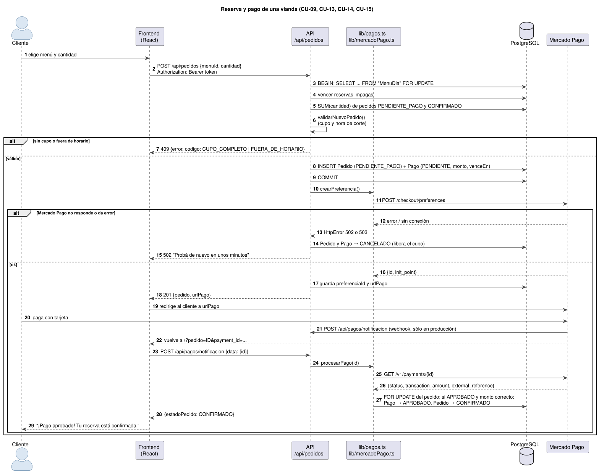
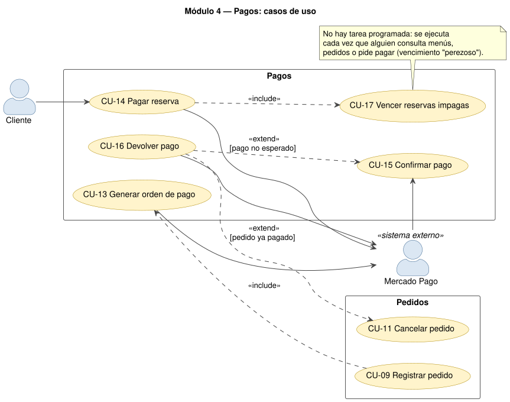
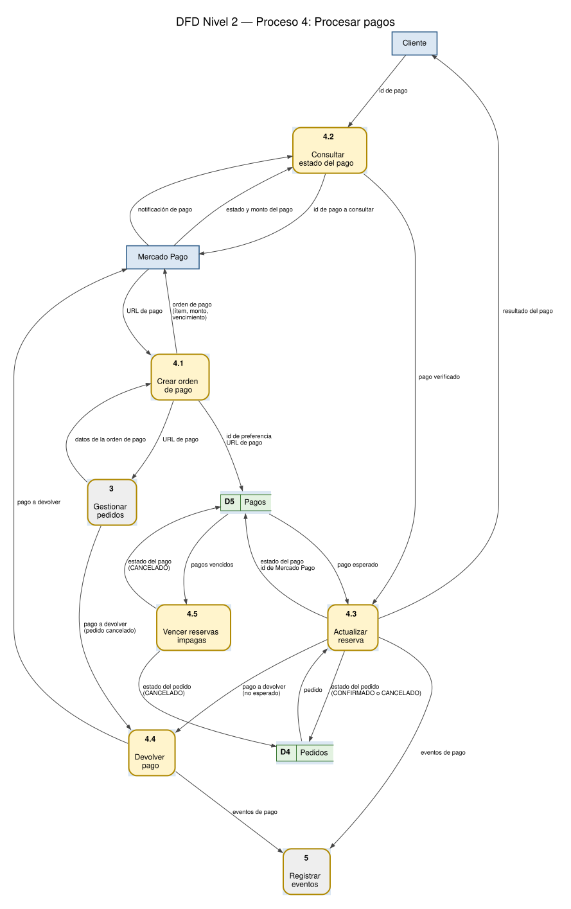

# Módulo 4 — Pagos

## 1. Propósito

Cobra el **100 %** de cada reserva con Mercado Pago (Checkout Pro) y mantiene el estado de la reserva
de acuerdo con el estado **real** del pago, que siempre se consulta a la API de Mercado Pago y nunca se
toma de lo que mande el navegador. También devuelve el dinero cuando corresponde y libera el cupo de
las reservas que no se pagan a tiempo. Corresponde al **proceso 4 "Procesar pagos"** de los DFD y es
la **tecnología avanzada** "integración con un servicio de terceros" de la consigna (sección 3.5),
incluido el comportamiento ante la falla o demora del servicio.

## 2. Dónde está en el código

| Capa | Archivo | Qué hace |
|---|---|---|
| Base de datos | `backend/prisma/schema.prisma` (modelo `Pago`, enum `EstadoPago`) | Un pago por pedido |
| Cliente de Mercado Pago | `backend/src/lib/mercadoPago.ts` | `crearPreferencia`, `obtenerPago`, `devolverPago` con `fetch` nativo (sin SDK) |
| Lógica de pagos | `backend/src/lib/pagos.ts` | `procesarPago` (confirma o devuelve), `vencerReservasImpagas`, `OCUPAN_CUPO` |
| Reglas (puras) | `backend/src/domain/reglasPedido.ts` | `vencimientoDelPago`, `estadoDelPago` |
| API | `backend/src/routes/pagos.ts` | Webhook `POST /api/pagos/notificacion` |
| API | `backend/src/routes/pedidos.ts` | Crea la orden al reservar, `POST /:id/pagar`, devolución al cancelar |
| Frontend | `frontend/src/App.tsx` (`volverDeMercadoPago`) | Al volver de Mercado Pago pide a la API que consulte el pago |
| Frontend | `frontend/src/pantallas/Pedidos.tsx` (`pagar`) | Botón "Pagar $…" para reintentar |
| Tests | `backend/tests/integration/pagos.test.ts` | 14 tests de integración (Mercado Pago simulado) |

## 3. Casos de uso

### CU-13 Generar orden de pago

| Campo | Detalle |
|---|---|
| **Módulo** | 4 — Pagos |
| **Actor principal** | (incluido en CU-09 Registrar pedido) |
| **Actores secundarios** | Mercado Pago |
| **Precondiciones** | El pedido y su pago `PENDIENTE` ya se guardaron (CU-09, paso 10). |
| **Endpoint externo** | `POST https://api.mercadopago.com/checkout/preferences` |

**Flujo principal**

1. La API arma la preferencia: un ítem con título "Vianda AAAA-MM-DD: descripción", cantidad y precio unitario en ARS; `external_reference` = id del pedido.
2. Agrega las URL de vuelta (`FRONTEND_URL/?pedido=ID`), la URL de notificación (`API_URL/api/pagos/notificacion`, sólo si hay URL pública), el vencimiento (`expiration_date_to` = vencimiento del pago) y excluye pagos en efectivo y cajero (se acreditan tarde).
3. La envía a Mercado Pago con el `MP_ACCESS_TOKEN` en el encabezado `Authorization`.
4. Mercado Pago responde el id de la preferencia y su `init_point` (URL de pago).
5. La API guarda `preferenciaId` y `urlPago` en el `Pago`.

**Flujos alternativos**

- **3a. Falta `MP_ACCESS_TOKEN`:** `503 "Los pagos no están disponibles en este momento"` y evento `mercadopago_sin_configurar`.
- **3b. Sin conexión con Mercado Pago:** `502` y evento `mercadopago_sin_conexion`.
- **4a. Mercado Pago responde con error:** `502`; el detalle va sólo al log (`mercadopago_error`).
- En todos los casos alternativos CU-09 cancela el pedido para liberar el cupo.

**Postcondiciones:** el pago tiene URL de pago y vence en Mercado Pago a la misma hora que en el sistema.

### CU-14 Pagar reserva

| Campo | Detalle |
|---|---|
| **Módulo** | 4 — Pagos |
| **Actor principal** | Cliente |
| **Actores secundarios** | Mercado Pago |
| **Precondiciones** | El cliente tiene una reserva `PENDIENTE_PAGO` sin vencer. |
| **Disparador** | Redirección automática después de CU-09, o botón "Pagar $…" en "Mis pedidos". |
| **Relaciones** | `<<include>>` CU-17 Vencer reservas impagas |
| **Endpoint** | `POST /api/pedidos/:id/pagar` → `200 { urlPago }` |

**Flujo principal**

1. El cliente toca "Pagar $…" en una reserva pendiente.
2. La API valida la sesión y el rol `CLIENTE`, y cancela las reservas vencidas (CU-17).
3. La API verifica que el pedido sea del cliente, siga `PENDIENTE_PAGO` y tenga URL de pago.
4. La API devuelve la URL de pago; el frontend redirige al cliente a Mercado Pago.
5. El cliente paga en la página de Mercado Pago (tarjeta o dinero en cuenta).
6. Mercado Pago avisa el pago a la API y devuelve al cliente al frontend; continúa en CU-15.

**Flujos alternativos**

- **3a. El pedido no existe o es de otro cliente:** `404`.
- **3b. Ya está pagado:** `409 NO_PAGABLE "Este pedido ya está pagado"`.
- **3c. Venció o se canceló:** `409 NO_PAGABLE "Esta reserva venció o se canceló. Hacé una nueva"`.
- **5a. El cliente abandona el pago:** al volver sin `payment_id`, el frontend avisa que puede pagar desde "Mis pedidos" antes de que venza.
- **5b. El pago es rechazado:** la reserva sigue pendiente y el cliente puede reintentar (vuelve al paso 1).

**Postcondiciones:** Mercado Pago tiene un pago asociado a la preferencia del pedido.

### CU-15 Confirmar pago ★ (caso de uso principal)

| Campo | Detalle |
|---|---|
| **Módulo** | 4 — Pagos |
| **Actor principal** | Mercado Pago (webhook). También lo dispara el frontend cuando el cliente vuelve de pagar. |
| **Actores secundarios** | Cliente (recibe el resultado) |
| **Descripción** | El sistema consulta el estado real de un pago y actualiza la reserva: la confirma, la deja pendiente o devuelve el dinero. |
| **Precondiciones** | Existe un pago en Mercado Pago cuyo `external_reference` es el id de un pedido. |
| **Disparador** | `POST /api/pagos/notificacion` con `{ type: "payment", data: { id } }` (o los mismos datos en la URL). |
| **Relaciones** | Extendido por CU-16 Devolver pago `[pago no esperado]` |
| **Endpoint** | `POST /api/pagos/notificacion` → `200 { pedidoId, estadoPedido, estadoPago }` (público: no lleva token) |

**Flujo principal**

1. Mercado Pago (o el frontend, al volver el cliente) envía el aviso con el id del pago.
2. La API ignora los avisos que no son de tipo `payment` (responde `200 { ignorado: true }`).
3. La API valida que el id sea numérico.
4. La API consulta `GET /v1/payments/{id}` a Mercado Pago: estado, monto, moneda y `external_reference`.
5. La API traduce el estado (`approved` → `APROBADO`, `rejected` → `RECHAZADO`, `cancelled` → `CANCELADO`, `refunded`/`charged_back` → `DEVUELTO`, el resto → `PENDIENTE`).
6. En una transacción, bloquea la fila del pedido (`FOR UPDATE`) para procesar de a un aviso.
7. Si el aviso ya se procesó (mismo id y mismo estado), no cambia nada (idempotente).
8. Si el pago está `APROBADO`, el pedido está `PENDIENTE_PAGO` y el monto y la moneda (ARS) coinciden: el pago pasa a `APROBADO` con el id de Mercado Pago y el pedido a `CONFIRMADO`; se registra `pago_aprobado`.
9. La API responde el estado del pedido y del pago; el frontend muestra "¡Pago aprobado! Tu reserva está confirmada." y abre "Mis pedidos".

**Flujos alternativos**

- **2a. Aviso de otro tipo (por ejemplo `merchant_order`):** `200 { ignorado: true }`, para que Mercado Pago no lo reintente.
- **3a. Id inválido:** `400`.
- **4a. El pago no existe en Mercado Pago:** `404`. **4b. Mercado Pago no responde:** `502` (Mercado Pago reintenta el webhook más tarde).
- **6a. El pago no corresponde a ninguna reserva:** `404 "El pago no corresponde a ninguna reserva"`.
- **8a. Pago pendiente, rechazado o cancelado:** el pago guarda ese estado y el pedido **sigue** `PENDIENTE_PAGO`; el cliente puede reintentar hasta que venza. El frontend muestra "El pago no se aprobó…" o "Mercado Pago está procesando el pago…".
- **8b. Pago aprobado pero la reserva ya estaba cancelada o vencida, el monto no coincide o la reserva ya estaba pagada con otro pago:** se ejecuta CU-16 Devolver pago y se registra `pago_devuelto`. Si el pedido no estaba confirmado, el pago queda `DEVUELTO`.
- **8c. Devolución o contracargo hecho desde Mercado Pago sobre una reserva confirmada:** el pago pasa a `DEVUELTO` y el pedido a `CANCELADO` (libera el cupo).

**Postcondiciones:** el estado de la reserva coincide con el estado real del pago en Mercado Pago.
Ninguna reserva se confirma sin un pago aprobado por el monto exacto.

**Reglas:** Mercado Pago es la única fuente de verdad del pago; repetir el aviso no cambia nada; dos
avisos simultáneos del mismo pago se procesan de a uno.

### CU-16 Devolver pago

| Campo | Detalle |
|---|---|
| **Módulo** | 4 — Pagos |
| **Actor principal** | (extiende CU-11 y CU-15) |
| **Actores secundarios** | Mercado Pago |
| **Condiciones de extensión** | CU-11: el pedido cancelado estaba pagado · CU-15: llegó un pago aprobado que no se esperaba |
| **Endpoint externo** | `POST https://api.mercadopago.com/v1/payments/{id}/refunds` |

**Flujo principal**

1. La API pide a Mercado Pago la devolución total del pago, con la clave de idempotencia `devolucion-{id}` (si se repite, Mercado Pago no devuelve dos veces).
2. Mercado Pago confirma la devolución.
3. La API marca el pago como `DEVUELTO` y registra `pago_devuelto` en el log.

**Flujos alternativos**

- **2a. Mercado Pago falla:** `502`. En CU-11 la cancelación se deshace (el pedido sigue vigente); en CU-15 el aviso falla y Mercado Pago lo vuelve a enviar.

**Postcondiciones:** el cliente recupera el dinero.

### CU-17 Vencer reservas impagas

| Campo | Detalle |
|---|---|
| **Módulo** | 4 — Pagos |
| **Actor principal** | (incluido en CU-05, CU-09, CU-10 y CU-14) |
| **Descripción** | Cancela las reservas cuyo plazo para pagar ya pasó, para que liberen el cupo. |
| **Función** | `vencerReservasImpagas()` en `lib/pagos.ts` |

**Flujo principal**

1. La API busca los pagos `PENDIENTE` con `venceEn` vencido cuyo pedido sigue `PENDIENTE_PAGO` y los pasa a `CANCELADO`.
2. Pasa a `CANCELADO` los pedidos `PENDIENTE_PAGO` cuyo pago venció.

**Postcondiciones:** ninguna reserva vencida ocupa cupo.

**Decisión de diseño:** no hay una tarea programada (cron). El vencimiento se aplica "a demanda" justo
antes de leer o contar el cupo, que es el único momento en que importa. Así no hace falta un proceso
extra en el servidor (que además se duerme en el plan gratuito de Render). Como la preferencia de
Mercado Pago vence a la misma hora, tampoco llegan pagos de reservas vencidas; si llegara uno, se
devuelve (CU-15, 8b).

## 4. DFD Nivel 2 — Proceso 4 "Procesar pagos"

| N.º | Proceso | Entrada | Salida | Almacenes |
|---|---|---|---|---|
| 4.1 | Crear orden de pago | datos de la orden de pago (de 3) | orden de pago → Mercado Pago; URL de pago → 3 | D5 (preferencia y URL) |
| 4.2 | Consultar estado del pago | notificación de pago (Mercado Pago), id de pago (Cliente) | id de pago a consultar → Mercado Pago; pago verificado → 4.3 | — |
| 4.3 | Actualizar reserva | pago verificado | resultado del pago → Cliente; pago a devolver → 4.4; eventos → 5 | D4, D5 (lee y escribe) |
| 4.4 | Devolver pago | pago a devolver (de 3 o 4.3) | pago a devolver → Mercado Pago; eventos → 5 | — |
| 4.5 | Vencer reservas impagas | pagos vencidos | — | D5, D4 (escribe `CANCELADO`) |

## 5. Datos que usa

| Tabla | Campos | Notas |
|---|---|---|
| `Pago` | `pedidoId` (único), `monto`, `estado`, `preferenciaId` (único), `urlPago`, `mpPagoId`, `venceEn`, `actualizadoEn` | `monto` en pesos = cantidad × precio |
| `Pedido` | `estado` | Pasa a `CONFIRMADO` sólo desde `procesarPago` |

## 6. API y servicios externos

| Origen → destino | Método y ruta | Para qué |
|---|---|---|
| Mercado Pago → API | `POST /api/pagos/notificacion` | Webhook de pagos (en producción) |
| Frontend → API | `POST /api/pagos/notificacion` | Al volver de pagar (indispensable en local, donde el webhook no llega) |
| Frontend → API | `POST /api/pedidos/:id/pagar` | URL para reintentar el pago |
| API → Mercado Pago | `POST /checkout/preferences` | Crear la orden de pago |
| API → Mercado Pago | `GET /v1/payments/{id}` | Estado real del pago |
| API → Mercado Pago | `POST /v1/payments/{id}/refunds` | Devolución total |

El webhook es público porque Mercado Pago no tiene token del sistema; no es un riesgo porque sólo
recibe un **id** y el estado se consulta a Mercado Pago con la credencial privada.

## 7. Reglas y validaciones

| Regla | Dónde |
|---|---|
| 30 minutos para pagar, nunca después de la hora de corte | `vencimientoDelPago` en `domain/reglasPedido.ts` |
| Sólo se confirma con pago aprobado, monto exacto y moneda ARS | `procesarPago` en `lib/pagos.ts` |
| Pago inesperado → devolución automática | `procesarPago` en `lib/pagos.ts` |
| Aviso repetido → sin cambios; avisos simultáneos → de a uno | `procesarPago` (comparación + `FOR UPDATE`) |
| Sin efectivo ni cajero (se acreditan tarde) | `crearPreferencia` en `lib/mercadoPago.ts` |
| El detalle de los errores de Mercado Pago no llega al usuario | `llamar()` en `lib/mercadoPago.ts` |

**Comportamiento ante falla o demora de Mercado Pago (consigna 3.5):** sin credencial → `503`; sin
conexión o con error → `502` con un mensaje claro, el detalle en el log y, al reservar, la reserva se
cancela para no ocupar cupo. Si la falla es al confirmar, Mercado Pago reintenta el webhook y el
cliente también puede volver a entrar a "Mis pedidos".

## 8. Pantallas

| Momento | Qué ve el cliente |
|---|---|
| Después de "Reservar y pagar" | "Te llevamos a Mercado Pago para pagar tu reserva…" y la página de Mercado Pago |
| Al volver | "¡Pago aprobado! Tu reserva está confirmada.", "Mercado Pago está procesando el pago…", "El pago no se aprobó…" o "La reserva ya estaba cancelada o vencida: te devolvimos el pago." |
| "Mis pedidos" | "Pagado", "Falta pagar", "Pago rechazado", "Pago no completado", "Cancelado · pago devuelto"; botón "Pagar $…" |

## 9. Tests que lo cubren (`pagos.test.ts`, 14)

Reserva pendiente con pago del 100 % y URL; confirmación sólo con pago aprobado; rechazado, cancelado
o pendiente no confirman y se puede reintentar; aviso con datos en la URL y avisos de otro tipo
ignorados; pago inexistente (404) e id inválido (400); monto distinto → devolución; pago de una reserva
cancelada → devolución; cancelar una reserva pagada → devolución; devolución desde Mercado Pago →
cancela; reserva sin pagar que vence y libera el cupo; no se paga un pedido ajeno ni uno ya pagado;
falla de Mercado Pago al crear el pago → reserva cancelada; menú sin precio. Mercado Pago se simula
reemplazando `fetch` (`simularMercadoPago()` en `tests/integration/ayudantes.ts`): los tests nunca
llaman al servicio real.

## 10. Para modificarlo

| Si piden… | Tocar |
|---|---|
| Cambiar el plazo para pagar | `MINUTOS_PARA_PAGAR` en `domain/reglasPedido.ts` (y su test) |
| Agregar un tiempo máximo de espera a Mercado Pago | `fetch` en `llamar()` de `lib/mercadoPago.ts` (por ejemplo `signal: AbortSignal.timeout(10000)`) y manejar el error como `502` |
| Mostrar el id de pago de Mercado Pago al cliente | `select` del `pago` en `GET /api/pedidos` (`routes/pedidos.ts`) → `tipos.ts` → `Pedidos.tsx` |
